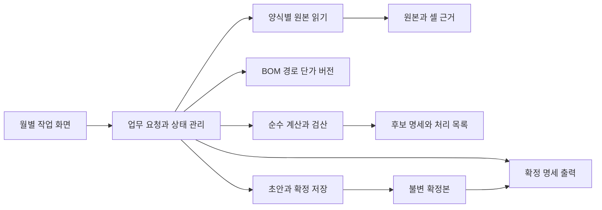

# 촉매 마감 1차 구현의 저장 구조와 개발 계획

> 최신 구현 상태: 2026-10-13 W2.1 희성 출하 읽기·적송재고 PDF 보조 인식·정정·원본 채택을 구현했습니다. ERP·유미코아 등 나머지 W2와 실제 마감 계산은 후속 단계입니다. 이전 절의 구현 전/다음 W2 표기는 당시 계획으로 보존합니다.

작성일: 2026-10-13. 갱신 상태: W1 실행·저장 기반 구현 및 검증 완료. 업무 수량 계산·확정·출력과 최종 UI는 후속 단계입니다. 검증 범위는 [W1 구현 기록](../reviews/2026-10-13-W1-구현검증.md)을 참고합니다.

한 달의 자료를 가져와 경로와 수량 근거를 연결하고, 필요한 예외를 처리한 뒤 확정·엑셀 출력까지 이어지는 프로그램을 만듭니다. **원본, 기본 계산, 사용자 수정, 확정본을 각각 보존하면서 서로 연결**하는 것을 구현의 중심으로 둡니다. 특정 시범 품번만 지원하지 않고 등록된 전체 품목에 동일 구조를 적용합니다.

업무 규칙은 [운영 설계](../reviews/2026-10-12-전체점검-운영설계.md)의 14~22절과 [상세 설계](../superpowers/specs/2026-10-08-촉매마감-자동화-design.md)를 따릅니다. 범위는 [Graphify 점검 후 정리한 1차 구현 범위](../../graphify-out/설계점검과_1차구현범위.md)를 구체화했습니다. 아래 기술 선택과 데이터 이름은 구현 제안이며, 새로운 업무 규칙에 대한 사용자 확정으로 취급하지 않습니다.

## 1. 기술 구성과 실행 방식

| 부분 | 기술 기본안 | 선택 이유와 경계 |
|---|---|---|
| 계산·업무 처리 | Python, 숫자는 Decimal 중심 | 기존 자료 분석과 연결하기 쉽고 계산을 화면에서 분리할 수 있습니다. 마감 공식은 이 계층에만 둡니다. |
| 업무 저장 | SQLite와 원본 파일 보관소 | 1인 로컬 사용에 맞춰 별도 DB 서버 없이 운영합니다. DB에 명세·버전을, 보관소에 실제 원본·출력 파일을 둡니다. |
| 화면 연결 | FastAPI 로컬 API | 자료 등록·계산·확정 요청을 검증하고 업무 처리에 전달합니다. API가 엑셀 셀이나 DB를 임의로 바꾸지 않습니다. |
| 화면 | React·TypeScript 기반 로컬 웹 화면 | 표·필터·근거 보기·오류 표시를 공통 요소로 구성합니다. 색상·레이아웃·최종 디자인은 화면 검토에서 정합니다. |
| 엑셀 읽기·출력 | Python의 양식별 어댑터, openpyxl 우선 검토 | 현재 확보한 XLSX 양식을 처리합니다. 계산 결과는 Python에서 확정하고 엑셀 출력에서 다시 배분하지 않습니다. |
| 검증 | Python 업무 테스트, 화면 주요 동작 테스트 | 실제 규칙과 실패·복구 시나리오를 검증합니다. 단순 필드 복사만 확인하는 테스트는 늘리지 않습니다. |

배포할 때는 실행 바로가기 하나로 로컬 서비스를 시작하고 브라우저를 열게 합니다. 화면의 정적 파일은 배포본에 포함하고 같은 로컬 서비스에서 제공합니다. 서버는 `127.0.0.1`에만 연결하며 외부 서버나 계정 로그인이 필요한 구조로 만들지 않습니다. 실행기가 서비스 상태·사용 포트·종료를 관리하고 동일 자료 폴더에 두 개의 쓰기 프로세스가 열리지 않게 합니다. 최종 실행 파일 포장 도구와 의존성 버전은 첫 실행 검증에서 잠급니다.

화면은 서버가 반환한 수량·금액·상태를 표시합니다. 브라우저에서 별도로 계산한 합계를 공식 마감값으로 사용하지 않습니다. 저장을 바꾸는 로컬 요청은 실행 세션과 같은 출처인지 확인하고, 파일 접근은 등록한 파일 ID와 선택한 자료 보관소 안으로 제한합니다.

Decimal은 십진수 계산과 반올림 방식을 제공하고, SQLite는 트랜잭션 단위 저장을 지원합니다. 이 기능을 사용하되 실제 확정·복구의 원자성은 아래 처리 순서와 실패 테스트로 검증해야 합니다. [Python Decimal](https://docs.python.org/3/library/decimal.html), [SQLite 트랜잭션](https://www.sqlite.org/transactional.html), [FastAPI 실행](https://fastapi.tiangolo.com/deployment/manually/), [React 구성 요소](https://react.dev/learn)를 확인했습니다.

## 2. 프로그램 내부의 책임



| 모듈 | 받는 값 | 반환하는 값 | 맡지 않는 일 |
|---|---|---|---|
| `imports` | 파일 ID, 자료 역할·기간, 양식 버전 | 원문 행·정규화 값·셀 근거·읽기 문제 | BOM 변경, 실제 마감 확정 |
| `masters` | BOM·경로·단가의 등록/변경안과 적용 월 | 변경 불가능한 기준 버전, 변경 영향 | 과거 확정본 수정 |
| `calculation` | 고정된 계산 입력 묶음 | 총량·배분 근거·자동 후보·최종 후보·미정산·검산 | 파일 읽기, DB 저장, 사용자 승인 |
| `workflow` | 자료 선택·입력·계산·확정 등의 요청 | 새 초안 개정, 처리 목록, 결과 ID | 화면 배치, 셀별 직접 계산 |
| `storage` | 검증된 명세와 저장 요청 | 저장 성공·버전·복구 가능한 오류 | 수량을 맞추는 보정 |
| `exports` | 확정본 ID 또는 명시적인 초안 결과 ID, 양식 버전 | 출력 파일·해시·생성 상태 | 최신 BOM으로 재계산, 출력별 별도 배분 |
| `ui` | 조회용 결과와 사용자가 입력한 값 | 업무 요청, 화면 표시 | DB 직접 편집, 마감 규칙 복제 |

폴더는 `backend/domain`, `backend/application`, `backend/adapters`, `backend/api`, `frontend`, `tests`로 나누는 안입니다. 업무 원본·DB·생성 엑셀은 코드 폴더 밖에 둡니다. Graphify는 개발 시 관계 점검 도구로 사용하며 프로그램 실행 의존성으로 넣지 않습니다.

## 3. 실제 파일과 데이터 보관

사용자가 자료 보관 폴더를 한 번 선택하고, 내부 경로는 프로그램이 관리합니다.

```text
선택한 자료 폴더/
  database/closing.sqlite
  originals/<파일 해시>/<보관 파일>
  exports/<마감월>/<확정본 ID>/<출력 파일>
  backups/<백업 ID>/
  staging/<작업 ID>/
```

원래 받은 엑셀·PDF를 수정하지 않고 `originals`에 복사해 해시를 확인합니다. DB에는 보관소 기준 상대 경로와 파일 ID를 기록합니다. 파일명·PC 드라이브가 바뀌어도 같은 원본과 확정 이력을 연결할 수 있어야 합니다. 동일 해시 파일의 실제 복사본은 하나만 두되 사용 월·자료 역할·조회 범위의 연결은 별도로 유지합니다.

파일 복사와 DB 저장은 하나의 SQLite 트랜잭션이 아닙니다. 원본 등록은 `임시 복사 → 해시 확인 → 보관소에 완성 파일 배치 → DB 등록 완료` 순서로 처리합니다. 마지막 저장이 실패하면 원본 등록 완료로 표시하지 않습니다. 남은 파일은 재시도 때 재사용 가능한 미연결 파일로 식별하며 기존 확정본이 참조하는 파일을 삭제하지 않습니다.

### 3.1 저장할 데이터 단위

아래 이름은 테이블 또는 테이블 묶음입니다. 큰 JSON 하나에 모든 거래를 넣는 대신 검색·제약이 필요한 관계를 명시적으로 저장합니다. 당시 입력값 전체를 재현하기 위한 JSON 스냅샷은 함께 보관합니다.

| 데이터 단위 | 주요 키와 값 | 제약·보존 조건 |
|---|---|---|
| `source_file`, `import_batch`, `source_record` | 파일 해시·보관 경로, 자료 역할·월·조회 범위·양식 버전, 시트·행·셀 또는 PDF 페이지·표 영역·원문 값·인식 방식/버전 | 해시 유일. 같은 파일 재등록은 수량을 추가하지 않음. 수정본은 대체 범위·이전 배치와 연결 |
| `master_version`과 BOM·경로·집계·마감처·단가 행 | 버전 ID, 제품·촉매, 소요량, 자료 항목 의미, 공장·ERP 귀속, 승인 근거 | 제품 M/H·접미사 보존. 기준 변경은 새 버전. 서로 겹치는 적용 후보를 임의 선택하지 않음 |
| `closing_month`, `draft` | 대상 월, 현재 확정본 ID, 초안 ID·개정 번호, 이전 확정본, 계산/입력 상태 | 월별 활성 초안 최대1개. 이전 확정본과 폐기 초안 보존 |
| `draft_source`, `draft_master`, `carry_reference` | 초안이 채택한 원본·기준 버전, 전월 확정본·미정산 행 | 복수 파일은 대상 범위가 분리된 경우만 병합. 전월 연결을 최신값 조회로 대신하지 않음 |
| `product_split`, `quantity_override` | 월·제품/경로 또는 촉매 대상군·세부 공장, 값·사유·근거·입력 개정 | 제품 분할과 촉매 수정을 분리. 공란과0을 구분. 자동값에 가산하지 않고 해당 범위를 대체 |
| `reconciliation_decision` | 양쪽 원천 값, 채택 수량·보완 근거·처리 상태 | 임의 차액 보정 금지. 입고·반품·기간 차이의 근거를 연결 |
| `carryover_override` | 초안·공급업체·촉매·재고 기준월·귀속 범위·원본 행, 원본/수정/적용 수량·사유·근거·개정·작업자·시각 | PDF 기본값과 수정 분리. 공란=원본, 0=명시적0. 인식 정정과 업무 조정 구분. 출처 교체 시 재검토. 공장별 배분 수정과 별개 |
| `pending_case`, `pending_event` | 촉매·공급업체·단가·귀속, 전월 잔여, 계속/해소/신규 보류 사건 | 보류별 ID로 중복 차감을 막음. 해소는 해당 잔여를 초과할 수 없음. 과거 사유 공란은 그대로 보존 |
| `calculation_run`, `pool`, `contribution`, `candidate_line` | 입력 지문·규칙 버전, 대상군 총량, 제품×BOM 기여, 반올림 전후·수정·최종 수량 | 실행마다 새 결과. 실패한 실행을 최신 성공 결과로 바꾸지 않음. 원본·기준·입력까지 역추적 |
| `review_issue`, `issue_evidence` | 문제 코드·범위·차단 여부·필요 행동·관련 근거 | 자료 문제 한 건 아래 영향 품목을 묶음. 단순 확인 클릭으로 수량 불균형을 해제하지 않음 |
| `closing_snapshot`, `closing_line`, `pending_balance`, `evidence_link` | 월·차수·이전 확정본·확정 시각, 명세·미정산·입력·근거 스냅샷 | 확정 행 수정 금지. 새 차수 생성. 세부 공장과 ERP 합계를 별개 거래로 중복 저장하지 않음 |
| `export_run`, `backup_run`, `audit_event` | 대상 버전, 양식·파일 해시·상태, 백업 파일 목록, 변경 전후·사유 | 출력 실패와 확정 실패를 구분. 일반 로그에 원본 전체나 키를 복사하지 않음 |

### 3.2 품번과 명세의 식별 기준

기본 배분 대상군은 `촉매 + 공급업체 + 적용 단가 조건 + 별도 귀속이 필요한 범위`로 식별합니다. 제품마다 같은 촉매의 총량을 만들지 않습니다. 상세 공장 명세는 `대상군 + 세부 공장/승인된 별도 마감처`에 연결하고 ERP 지역 합계는 그 명세에서 계산합니다. 세부 공장을 모르는 값은 알려진 ERP 지역값과 별도 상태로 보존하며 임의 공장 코드를 채우지 않습니다.

행 ID는 내부 식별자이고 품번 문자열 자체는 원문·정규화 값을 함께 둡니다. 별칭 규칙에는 대상 자료·품목 유형·버전을 둡니다. 정확한 품번 예외가 미확인이면 낮은 우선순위의 포괄 규칙으로 우회하지 않습니다. 촉매 제외 코드와 그 촉매를 구성품으로 사용하는 제품의 수불을 혼동하지 않습니다.

### 3.3 숫자와 공란

확정 촉매 수량은 정수, 원본 수량·BOM 소요량·단가는 부호와 소수 자릿수를 보존합니다. 계산 입력·DB의 십진수는 표준화된 문자열로 보관하고 Python Decimal로 읽습니다. SQLite REAL이나 브라우저 부동소수점 합계를 공식 금액의 기준으로 삼지 않습니다. 비율은 분자·분모를 함께 남기고 반올림 경계는 정확한 비율로 판단합니다.

수량 배분은 기존 합의의 양수0.5 올림을 사용합니다. 금액의 원 단위 처리·천원 표시 정책은 양식별로 버전을 두고 원본 대조로 확인합니다. 금액 정밀도까지 수량의 반올림 규칙으로 일괄 결정하지 않습니다. `NaN`, 무한대, 허용하지 않은 분수 수량은 오류로 표시합니다. 원본의 실제 음수 출하·반품을0으로 바꾸지 않습니다.

입력은 값뿐 아니라 `미입력/입력됨/자료 미제공` 상태를 둡니다. 촉매 수정의 공란은 자동값 사용이고 제품 분할의 필수 공란은 입력 필요입니다. 문자열0·숫자0은 명시적0이며 자료에 행이 없는 것은0이 아닙니다.

## 4. 계산 모듈의 입력과 출력

`CalculationInput`에는 대상 월, 초안 개정, 채택 원본과 추출 행, 기준 버전의 실제 값, 전월 확정 미정산, 촉매사 PDF 이월 원본·검증 상태·이월 수정·최종 적용값, 원천 차이 처리, 보류 사건, 제품 분할, 촉매 수정, 계산·정밀도·반올림 정책 버전을 포함합니다. 계산 중에 현재 기준표나 디스크의 다른 파일을 다시 읽지 않습니다.

`input_fingerprint`는 위 입력을 정해진 순서로 직렬화한 해시입니다. 수량이 같더라도 원본 수정본·BOM·근거가 달라지면 다른 입력으로 기록합니다. 같은 입력과 규칙 버전은 같은 결과를 내야 하며, 행 읽기 순서가 달라도 반올림 동률은 등록된 순서로 해결합니다. 전체 입력 지문과 별개로 대상군별 `basis_fingerprint`를 두어 수정 재검토 범위를 찾습니다. 이 근거 지문에는 사용자 수정값 자체·실행 시각·계산 ID를 넣지 않아, 수정 입력이나 동일 근거 재실행만으로 스스로 무효화되지 않게 합니다.

| 계산 단계 | 입력 | 결과 및 실패 조건 |
|---|---|---|
| 월 대상 생성 | 거래·이월·BOM·경로·등록된 제외 규칙 | 활성 대상과 포함/제외 이유. 계획 없음·단산만으로 실제 거래 삭제 금지 |
| 제품 근거 연결 | 제품/반제품 수불, 집계 규칙, 월별 분할 | 경로별 수량·원본 근거·집계/후속 추적 구분. 사용 수량의 중복 소유를 검사 |
| 원천 정합 | 촉매사 이월+납품, 자체 이월+ERP, 보완 근거 | 양쪽 구성과 채택 가용량. 08070의0+263과95+168을 섞지 않음 |
| 보류와 별도 귀속 | 보류 사건, 글로비스 실제 입고, BOM·촉매 예외 | 계속/해소/신규 보류, 글로비스 확정 후보, 직사급 별도 처리. 예정 월 자동 해소 금지 |
| 배분 대상군 생성 | 채택 가용량, 보류 잔여, 별도 귀속분 | 일반 배분 대상 수량. 음수거나 귀속 근거 미확인이면 차단 문제 반환 |
| 일반 배분 | 대상군별 총량, 세부 공장별 제품×BOM 합계 | 비율·반올림 전 수량·정수 수량·반올림 조정. 분모0은 균등 배분하지 않음 |
| 월별 수정 | 자동값, 해당 입력에 유효한 촉매 수정·사유 | 자동값을 보존한 최종 후보. 한쪽 수정의 차이를 다른 공장에 자동 전가하지 않음 |
| 금액·검산 | 후보, 적용 단가, 귀속별 입고·이월·미정산 | 명세 금액, 수량 균형, 공장/ERP/공급업체 합계, 처리 목록 |

원천 입력은 이미 전월 잔여를 포함합니다. 전월 보류가 계속되는 부분만 일반 배분 가용량에서 제외하고, 해소된 부분은 다시 이월이나 입고로 더하지 않습니다. 신규 보류도 실제 원천에 포함됐는지를 확인합니다. 반품·정정은 근거 있는 원천 조정으로 처리하며 음수 최종 배분 입력으로 대신하지 않습니다.

유미코아의 이미 구분된 명세는 그 구분을 유지합니다. 배분이 필요한 범위만 공통 계산기를 사용하고, 공급업체별 원본 읽기 차이를 공통 계산식 안의 품번별 조건문으로 흩어놓지 않습니다.

`CalculationResult`는 다음을 반환합니다.

- 상태: 처리 가능한 후보가 있는 `partial`, 필수 조건이 갖춰진 `ready`, 실행 자체가 실패한 `failed`를 구분합니다. `ready`도 사용자 월 확정 전에는 초안입니다.
- 대상군별 원천 구성·가용량·보류·별도 마감·일반 배분·잔여와 근거.
- 세부 공장별 자동값·반올림 조정·사용자 수정·최종값·단가·금액 및 관련 제품 기여.
- 귀속별 미정산과 전월 행·보류 사건 연결.
- 원인별 문제와 영향 범위, `blocks_finalize`, 필요한 행동, 원본 위치.
- 검산 차이 및 전체 대상의 포함·제외·미완료 분류. 실패 항목을 없애 전체 합계가 맞아 보이게 하지 않습니다.

## 5. 초안 상태와 화면 요청

초안은 자료 선택이나 입력을 저장할 때마다 개정 번호가 올라갑니다. 계산 결과에는 입력 개정 번호가 붙습니다. 현재 개정과 다르면 결과를 지우지 않고 ‘재계산 필요’로 표시합니다. 계산 중 새 입력이 생기면 뒤늦게 끝난 예전 계산은 이력으로만 저장하고 현재 결과로 채택하지 않습니다.

| 화면 동작 | 업무 요청의 필수 값 | 결과·처리 |
|---|---|---|
| 월 작업 시작 | 월, 전월 확정본 또는 초기 이관 출처 | 활성 초안 반환. 같은 월 중복 초안을 만들지 않음 |
| 자료 등록·교체 | 파일, 역할·조회 범위, 대체 범위, 예상 초안 개정 | 원본 보관·차이 표시 후 개정 증가. 교체 실패 시 기존 채택본 유지 |
| 제품 분할 입력 | 제품·경로·공장별 수량·근거, 예상 개정 | 해당 자동 제품 근거를 대체. 촉매 수정과 다른 요청 |
| 촉매 수정 입력 | 대상군·공장, 최종 수량·사유, 기준 계산 ID·예상 개정 | 자동값·수정 전후 보존. 해제 요청과0입력 구분 |
| 자료 차이·보류 처리 | 문제/보류 ID, 처리 수량·시점·근거·사유 | 원천/보류를 갱신하고 재계산 필요 |
| 계산 | 초안 ID·예상 개정 | 실행 ID 반환, 완료 시 후보·처리 목록 표시 |
| 근거 보기 | 후보 또는 확정 명세 ID | 총량→경로 기여→원본 셀과 사용자 판단까지 조회 |
| 월 확정 | 최신 계산 ID·입력 지문·예상 개정·요청 식별키 | 전제 일치·필수 문제 없음 확인 후 확정본 ID 반환 |
| 수정 시작·재확정 | 기준 확정본 ID, 수정 사유 | 기존 확정본을 보존한 새 초안, 이후 새 차수 생성 |
| 출력 | 확정본 ID·출력 종류·양식 버전 | 저장된 명세로 생성. 초안 출력은 별도 상태·표기 |

위는 업무 계약이며 상세 URL은 API 구현에서 정합니다. 공통 오류 응답은 오류 코드, 사용자가 할 일, 영향 품목/대상군, 관련 원본 위치를 반환합니다. 오래된 개정에 대한 저장은 충돌로 알려주고 최신 초안을 다시 읽게 합니다. 자료 선택창 취소는 오류나 자료0건으로 기록하지 않습니다.

사용자 수정은 재계산 시 남겨 둡니다. 해당 대상군의 원본·BOM·수량 근거·가격·귀속 또는 전월 연결이 바뀐 경우에만 `수정 재검토`로 표시합니다. 재검토 없이 기존 수정값을 새 근거의 공식 결과로 확정하지 않습니다. 영향 계산을 확신할 수 없는 범위는 좁혀서 재검토할 수 있도록 표시하며 모든 품목을 무조건 다시 승인받지 않습니다.

제품 분할은 해당 경유처·기간·제품의 원본 총수량과 공장별 입력 합계를 대조합니다. 총수량이 확인되지 않으면 합계가 맞는다고 표시하지 않고 보완 근거를 요구합니다. 근거 있는 총수량 변경은 원천 처리로 연결하며, 제품 분할 입력만으로 원본 수량을 늘리거나 줄이지 않습니다.

화면 표·필터는 읽기 전용 조회 모델을 사용합니다. 총량은 원천·사건에서 산출된 값으로 표시하며 이유 없는 총량 덮어쓰기 칸은 두지 않습니다. 내부 버전 번호·해시 등은 상세 근거에서 확인하고 기본 작업 화면에는 필요한 상태·차이·행동을 우선 표시합니다.

## 6. 확정 저장과 복구

1. 확정 전에 최신 초안 개정·계산 입력 지문·전월 연결·원본 보관 상태를 검증합니다. 필터 밖의 필수 미완료도 포함합니다.
2. 쓰기 트랜잭션 안에서 위 전제를 다시 확인하고 확정 차수를 배정합니다. `월+차수`, 확정 요청 식별키의 유일 제약을 둡니다. 같은 요청 재시도는 기존 결과를 돌려줍니다.
3. 명세·미정산·기준/원본/입력 스냅샷·전월 연결·감사 기록·현재 확정본 지정을 같은 트랜잭션으로 저장합니다. 중간 오류는 전체 롤백하며 초안과 이전 확정본을 유지합니다.
4. 확정 성공 후 엑셀 생성과 백업 작업을 시작합니다. 실패하면 각각 ‘출력 실패’·‘백업 재시도 필요’로 표시하고 확정본을 되돌리거나 완료로 숨기지 않습니다. 백업 완료까지 운영 점검에 남깁니다.
5. 출력은 임시 파일에 생성하고 열기·명세 합계·대상 월·단위·해시를 검증한 다음 고유한 완성 파일명으로 옮깁니다. 파일 생성과 DB 기록 사이 장애는 작업 ID로 복구하며 기존 파일을 덮어쓰지 않습니다.

SQLite의 일관된 DB 백업을 먼저 만들고 그 백업이 참조하는 원본·출력·기준 파일 목록과 해시를 함께 묶습니다. 백업 중 생성된 이후 차수는 해당 백업에 포함됐다고 표시하지 않습니다. 실행 중 DB 파일 하나만 단순 복사해 완전한 백업으로 간주하지 않습니다. [SQLite Backup API](https://www.sqlite.org/backup.html), [Python sqlite3 백업](https://docs.python.org/3.13/library/sqlite3.html#sqlite3.Connection.backup)을 사용합니다.

복구는 별도 위치에서 DB 무결성·파일 해시·확정 합계·이월 연결을 확인한 뒤 자료 보관소를 전환합니다. 스키마 버전은 코드에 포함하고 변환 전 백업, 복사본 변환, 결과 검증 후 전환 순서를 적용합니다. 기준 버전이 없는 과거 이관값에 현재 기준을 소급해서 채우지 않습니다.

## 7. 엑셀 양식과 수식 처리

읽기 어댑터는 파일명만으로 자료 종류·월을 정하지 않고 시트·제목·필수 열·기간·제어 합계를 확인합니다. 열 문자와 업무 항목 의미를 함께 관리합니다. 원문 수식, 저장된 결과값, 계산에 사용한 정규화 값을 구분합니다.

openpyxl은 수식을 계산하지 않습니다. 수식 결과가 없거나 외부 링크 결과의 유효성을 확인할 수 없으면0으로 바꾸지 않고 양식별 대응 가능한 산식으로 직접 검산하거나 재계산된 자료가 필요하다고 표시합니다. 기존 분석 과정에서 사용한 엑셀 수식 엔진의 동작을 프로그램에 자동 승계하지 않습니다. [openpyxl 수식 문서](https://openpyxl.readthedocs.io/en/stable/simple_formulae.html).

출력은 저장된 확정값을 사용하고 표시용 소계도 같은 명세에서 만듭니다. 원본 양식 제목의 지난달 월이나 잘못된 천원 표기를 그대로 복사하지 않습니다. 현대기아 세부공장표와 ERP 거래처별 표는 검토 명세이며, 실제 등록 규격을 확인하기 전 자동 업로드 파일이라고 부르지 않습니다.

## 8. 구현 작업과 인수 기준

각 단계는 작동하는 결과와 통과해야 할 조건으로 나눕니다. W1은 구현 기록의 범위로 검증했으며 W2~W7은 앞으로 실행할 작업입니다.

| 작업 | 선행 | 구현 결과 | 통과 기준 |
|---|---|---|---|
| W1 실행 기반·저장 뼈대 | 없음 | 로컬 실행기, 최소 월 작업 화면, 자료 폴더·DB 버전, 초안 저장 | 공백·한글 경로에서 실행, 종료/재실행 복원, 중복 실행 차단, 저장 실패 시 입력 유지. 화면은 임시 스타일 |
| W2 원본 보관·읽기 | W1 | 역할별 어댑터, 원문·셀/PDF 영역 근거, 적송재고 PDF 인식·검산·정정, 중복/수정본 처리 | ERP·제품/반제품·희성·유미코아·글로비스 현재 양식의 전체 행 대조. 8월 말 PDF→9월 이월, 희성10,953·유미코아610 검산. 수식 공란·기간 부족·열 변경 감지 |
| W3 기준·초기 이관 | W2 | BOM·경로·집계·마감처·단가 버전, 과거 명세·미정산 이관 | 108품번·123경로를 양산 수와 혼동하지 않음. 정확 품번 예외·M/H·단가 후보 보존. 미확인 기준 표시 |
| W4 계산·검산 | W3 | 고정 입력 기반 계산 모듈, 처리 목록 | 아래 업무 사례와 총량·귀속·반올림 불변조건 충족. 동일 입력 재실행 및 원본 행 순서 변경에도 결과 일치 |
| W5 입력·검토 화면 연결 | W4 | 분할·수정·보류 처리, 근거 보기, 재계산 영향 | 빈칸/0, 한쪽 수정 합계 차이, 입력 중 재계산, 필터 밖 미완료 검사. 오래된 화면의 저장 거절 |
| W6 확정·출력·백업 | W5 | 불변 확정본, 재확정, 이월 영향, 4종 출력, 복구 | 확정 중 실패·중복 요청, 출력 실패, 새 BOM 후 과거 재출력, 다른 위치 복구의 수치·근거 일치 |
| W7 전체 월 대조·배포 | W6 | 9월 전체 비교표, 미해결 분류, Windows 실행본 | 97촉매·114확정 명세·61미정산 행 및 원천154촉매 대상 분류 연결. 전건 자동 재현과 과거 확정 대조를 구분하고 실제 PC에서 시작부터 출력까지 확인 |

W1에서 화면과 실행 방식을 확인하고 W5에서 업무 입력을 완성합니다. UI를 마지막에 한꺼번에 붙이지 않습니다. 외부 API·AI 범용 양식 해석, 자동 시스템 등록, 누적 대시보드 고도화는 1차 후순위입니다. 다만 제공된 적송재고 PDF 두 양식의 이미지 인식·검산·수동 정정은 W2에 포함합니다. 로컬 OCR을 우선 검토하고 도구 선택·인식 정확도는 구현 시 검증합니다. 이월 수정·원본 복귀·수정 사유 입력과 재계산은 W4~W5에 포함하며 운영 설계 23절의 인수 기준을 적용합니다. 유보 경로 자동 결정은 보류하되 해당 거래를 보존하고 미완료를 표시하는 기능은 W3~W5에 포함합니다.

### 8.1 반드시 포함할 업무 사례

| 사례 | 기대 결과 |
|---|---|
| 세종2JAV0·UCC 후속 이동 | J100의8,400을 근거로 사용하고 N100의8,880 및 후속 울산 이동을 다시 더하지 않음 |
| 공유 촉매와 서로 다른 BOM 소요량 | 제품 기여를 합산해 해당 대상군 총량을 한 번만 배분. 동률 반올림도 결과 재현 |
| 글로비스 | 과거 대조 기준18,538 마감, 잔여450=미입고449+전월1. 일반 배분의 잔여 조정에서 제외 |
| 28991-4C520 | 제품 글로비스 입고100이 전주 마감100으로 복제되지 않음. 대여270·예정월은 별도 사건 |
| 유미코아08070·월말 발주 | 0+263과95+168을 각각 대조.95+263 중복 금지. 발주만으로 납품 생성 금지 |
| 세정2J540 | 아산·화성3 제품 분할은 자동 근거를 대체. 미입력은 입력 필요, 명시적0은0 |
| 월별 촉매 수정 | 기본값 보존, 사유 필수, 한쪽 변경의 총합 차이 표시, 그달 수정이 다음 달 규칙으로 복제되지 않음 |
| 반제품·개발·AS·단산 | 승인된 적송·이동 근거, 모비스 정확 품번 예외 우선. 실제 거래·이월은 계획 유무와 무관하게 보존 |
| 원천 차이와 과거 비교 차이 | 희성 각2개 입고 문제와 과거 비율 차이를 다른 코드로 표시. 과거값을 맞추는 자동 보정 금지 |
| 전월 재확정 | 다음 달 이월 차이와 영향만 표시. 다음 달 기존 확정본 자동 변경 금지 |

수량 불변조건은 `채택 가용량 = 별도 마감 + 일반 마감 + 월말 미정산`이며 실제 조정은 근거 있는 원천 항목으로 포함합니다. 세부 공장 합계는 ERP 지역 합계와 같고, 각 출력은 동일 확정 명세와 같아야 합니다. 근거가 부족한 대상군을 계산 결과에서 제거해 전체 검증을 통과시키지 않습니다.

### 8.2 검증 자료의 구분

Git에는 업무 규칙을 검증할 가상 사례만 둡니다. 실제9월 자료 테스트는 별도로 제공된 로컬 폴더에서 읽기 전용으로 실행합니다. 원본 없이 실행하면 건너뛴 검증 범위를 명확히 표시합니다. 공개 테스트에 실제 품번별 단가·거래 전체를 복제하지 않습니다.

과거 대조 기준151,090개·19,870,764,335원·미정산20,874개는 기존 문서의 확인값입니다. 이관·출력 재현에서는 이 값을 대조하되, 현재 수불로 계산한 공장별 자동 후보가 과거와 모두 같아야 한다는 조건으로 사용하지 않습니다. 현재 원본·보완 판단만으로 처리 불가능한 항목은 미완료 또는 승인 근거 있는 처리로 남겨야 합니다.

## 9. 현재 남은 사항과 다음 작업

이번 계획으로 저장 단위, 계산 입출력, 화면 요청, 저장 실패·복구 처리, W1~W7의 인수 기준을 정리했습니다. W1 월 작업·메모 저장·재실행 복원·단일 실행을 구현하고 백엔드 및 Edge 브라우저에서 검증했습니다. 실제 엑셀/PDF 읽기·수량 계산·확정 테스트는 아직 수행하지 않았습니다. 단독 실행 파일 배포는 W7이며 최종 UI는 별도 검토합니다.

원천 전표 차이, 유보 경로, 현대기아 실제 업로드 규격과 일부 금액 표시 정책은 해당 기능의 검증 대상으로 남깁니다. 이를 모두 사용자가 먼저 답해야 개발할 수 있는 목록으로 만들지 않습니다. 알려진 규칙과 명시적 미완료 처리를 함께 구현하고, 자료로 해결되지 않는 실제 업무 판단만 구체적으로 질문합니다.

**다음 작업은 W2입니다.** 실제 원본의 보관·역할/기준월 등록·재등록 중복 방지·수정본 연결부터 구현하고 양식별 읽기를 연결합니다. 촉매사 적송재고 PDF는 운영 설계 23절대로 원본값·수정값·적용값을 분리합니다.

기존 Graphify 그래프는 이 계획을 작성하기 전 문서4개의 스냅샷입니다. 이번에는 기존 그래프를 조회해 관련 근거를 찾고 원문을 확인했습니다. 새 계획과 변경된 안내 문서는 아직 그래프에 재추출하지 않았으며, 앞으로 구조 질의 시 이 계획을 함께 확인하거나 그래프를 갱신해야 합니다.
