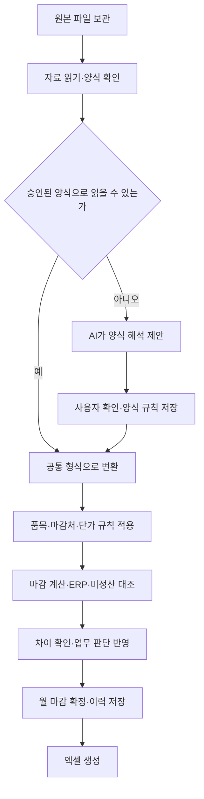

# 촉매 마감 자동화 프로그램 설계

> 현재 상태와 운영 역할의 기준은 [2026-10-12 전체 점검·운영 설계](../../reviews/2026-10-12-전체점검-운영설계.md)다. BOM·소요량 수령 후 11개 파일을 재점검했다. 9월 마감/ERP/미정산은 일치하지만 현재 누적 시트의 9월 누락, 과거 표 간 차이, 계획 버전 차이는 별도 이관 과제로 남아 있다. 아래 문서는 세부 업무 규칙과 확인 이력을 보존한다. 프로그램은 아직 미구현이다.

## 2026-10-12 후속 확인: BOM·물류 경로·세부 마감처

**2026-10-13 사용자 추가 확인 — 기본 비율과 월별 예외:** 기본적으로 제품 수량 비율로 계산하지만 일부 품목은 비율대로 마감하지 않는 달도 있다. 공통 계산은 비율 배분으로 두고, 필요한 품목만 해당 월의 세부 공장별 최종 촉매 수량을 수정할 수 있게 한다. 자동값·수정값·사유·변경 전후를 보존하고 세부 공장 합계를 ERP 마감처로 집계한다. 미입력은 자동값, 명시적 0은 0개다. 수정한 공장 외에 잔여를 임의 배분하지 않으며, 총량 차이는 별도 미정산·조정 근거 없이 확정하지 않는다. 예외를 다음 달 또는 영구 경로 규칙에 자동 반영하지 않는다. 과거 결과와 비율 후보가 다르다는 사실만으로 오류로 판정하거나 과거 전 건 자동 재현을 진행 조건으로 삼지 않는다. 개별 과거 예외 여부는 추정하지 않으며, 사용자가 별도로 확인한 2JAV0 당시 비율 배분은 유지한다. 상세 검토와 견본은 운영 설계 20절을 따른다.

**최신 정정 우선:** 아래 과거 확인 기록의 글로비스 포괄 규칙보다 촉매 `28991-4C520`의 전주공장 직사급 예외를 우선한다. 제품이 글로비스로 가더라도 이 촉매는 현대 전주 마감이다. 같은 제품의 다른 촉매까지 전주로 변경하지 않으며 직사급 수량 근거는 별도 관리한다. 영천 `2JAT0·2JAH0`은 울산5, 장안 `2JAS0`은 광주2, 장안 `08450`은 화성2, 세정 `2J730`은 모비스로 확인됐다. `2JAT0` 단산은 영천 경로에 한정한다.

`M28950-08010`은 단산 이력으로 보존하고 `H28950-08010`과 별도 관리한다. H품번은 동희/기아 화성 경로와 9월 생산입고·적송출고 각 172개를 확인했다. BOM 사용 여부·운영 상태·당월 실적 발생을 분리하며 단산품의 잔여 실적을 양산 복귀로 해석하지 않는다. 공용 촉매 이력을 한 제품에 전부 귀속하지 않는다. 월별 마감과 ERP 누적의 교차 대조 근거는 운영 설계 12절 및 통합 경로 엑셀에 보관한다.

- 사용자 추가 확인: 현대·기아 마감수량 입력용 **세부 공장**과 우리 ERP의 **통합 마감처**를 분리한다. 세종공업 경로는 울산3공장, 포레시아 영천 경로는 품번에 따라 울산1공장 또는 울산5공장이다. ERP에서는 공장 번호 없이 울산공장으로 합산한다. 영천의 개별 품번별 1·5공장 연결은 아직 확인하지 않았으므로 임의 배정하지 않는다. 상세 관리 구조는 5.2.4절에 반영한다.

- 사용자 확인: `M28520-08750_US`는 현대 울산 창고를 통한 **울산엔진 직납 WCC**, `M28950-2JAV0`의 세종공업·포레시아 영천 경로는 **1차사 경유 후 현대 울산 창고로 들어가는 UCC**다. 같은 현대 울산 창고의 기록이라도 품번·물류 경로에 따라 비율 집계 여부가 달라진다. 최종 촉매 마감처와 품번별 물류 경로를 분리하며 세부 구조는 5.2.3절에 정한다.

- 사용자 확인: 세종공업 등 1차사 창고의 제품이 이후 현대·기아 창고로 이동하면서 수불에 다시 기록되므로 같은 물량이 중복된다. 배분 근거를 계산할 때 중간 입고와 이후 입고를 단순 합산하지 않는다. 다만 세종공업 입고 8,400개가 현대 울산 입고 16,411개에 정확히 같은 수량으로 포함된다는 전표별 검증을 한 것은 아니며, 두 값을 기계적으로 차감하는 규칙을 만들지 않는다.
- 컨버터 물류는 3가지로 구분한다. **WCC는 엔진공장 직납(광명엔진·울산엔진·아산엔진·위아), UCC는 1차 머플러사 납품, PUPE·E2.9는 완성차 공장 직납**이다. 구분과 집계 지점은 5.2.2절에 반영한다. 사용자가 완성차 직납의 세부 기준을 추후 정리하기로 했으므로 지금 확정하거나 재질문하지 않는다.

- 수불 열 사용자 확인: `M28550-08510`의 기아-광명(화성) 870개·현대-울산(화성) 60개는 **당월 입고 이동처리(J열)**를 사용해 870:60 비율을 구한다. 당월 출고 합계 1,078개·34개는 이 배분 근거로 사용하지 않는다. 이 확인을 다른 모든 창고의 수량 열까지 승인한 것으로 확대하지 않는다.

- 사용자 확정 공통 규칙: **동일 제품 또는 동일 촉매가 여러 창고·납품처에 들어가면, 마감처별 제품 수량 비율을 촉매 매입 마감 대상 총수량에 적용한다. M28550-08510뿐 아니라 나머지 해당 품번과 향후 추가 품번에도 동일하게 적용한다. 제품 수량을 촉매 마감 수량으로 그대로 복사하거나 제품 수량만큼으로 마감을 제한하지 않는다.** 이 배분 원칙을 품번마다 반복 질문하지 않는다. 창고 수량으로 구하는 것은 비율이며, 그 비율을 적용할 총량은 별도의 촉매 매입 마감 대상 수량이다. 글로비스만 실제 제품 입고 수량에 BOM 소요량을 연결해 촉매 정산 수량을 정하는 예외다. 창고별 수량 기준과 실제 제품 마감 수량 직접 입력 방식은 모두 배분 비율의 근거를 정하는 방법이다. 구체적으로 어떤 수불 열을 읽는지와 중복되지 않는 집계 경로는 승인된 기준을 따른다.

- 세정 `M28950-2J540` 사용자 정정: 현대 아산 단독이 아니라 **현대 아산·기아 화성 분할**이다. 해당 월에 제품이 어느 마감처로 얼마만큼 마감되었는지에 맞춰야 하며, 사용자는 마감 시 직접 입력할 필요가 있다고 설명했다. 수불 입고 이동처리 1,680개나 BOM의 단일 마감처로 배분을 확정하지 않는다.
- 구현 설계: 대상 월·제품 품번·마감처별 제품 마감 수량을 사용자가 입력하고, 해당 실적 비율과 BOM 소요량으로 촉매 배분 후보를 계산해 검토한다. 미입력과 실제 0을 구분하며, 두 수량 합계가 0이면 비율을 만들지 않는다. 세정과 이후 아산·화성 창고 물량을 중복 합산하지 않는다. 최종 촉매 마감 확정과 수량 조정은 별도다. 다른 세정 품번으로 이 예외를 확대하지 않는다.
- 현재 8열 창고 연결표는 월별 수량 입력·분할 계산을 표현할 수 없으므로 해당 규칙은 비고에 월별 입력 예외로 명시하고 확인필요를 유지한다. `기아-화성(화성)`의 동일 품번을 현대 아산으로 보낸 초안도 정정했다. 입력 화면·배분 기능은 아직 구현하지 않았다.

- 후속 사용자 확정: **ERP 창고명이 `글로비스-`로 시작하면 모두 현대 글로비스로 마감한다. BOM의 마감처보다 이 창고 규칙이 우선한다. 수량은 반드시 실제 제품 입고처리 기준이며 ERP 입고 이동처리 수량으로 대체하지 않는다.** 글로비스-전주도 현대 전주가 아닌 현대 글로비스다. 초안의 BOM 기반 전주 제안은 폐기했다. 실제 제품 입고 기준은 기존 합의 사항이며 다시 질문하지 않는다. 둔포·아산·울산·전주 4개 규칙은 연결표의 수량 기준 `실제 제품 입고 확인`, 상태 `확인완료`로 반영했다. 현재 확인완료 13행·확인필요 57행이다. 월별 실제 입고 자료 출처·기준일의 연결은 별도 작업이며 업무 기준이 미확정이라는 뜻이 아니다.

- BOM과 2026년 9월~2027년 1월 촉매 소요량 파일을 로컬에서 수령했다. 소요량 파일은 제품별 포캐스트를 가공한 결과이며, 원본 포캐스트 수령이나 월계획 기준 사용 승인을 의미하지 않는다. 아래의 미수령 기록은 10월 8일 당시 상태다.
- 개발 이벤트·A/S용 반제품 8개를 사용자가 BOM에 추가하고 촉매사용구분을 `사용`으로 입력했다. 해당 범위의 수불 품번 19개는 모두 BOM에 존재한다. 월계획에 없다는 이유로 실제 수불·마감 검토에서 제외하지 않는다.
- 사용자 확인: 원자재(창고+라인)의 `H28950-03AA0`, `H28950-04200`, `H28950-04AD0`, `H28950-04AE0`, `H28950-04AF0`, `H28950-04BA0`은 **출고 적송처리** 수량을 사용하고 **현대 모비스**로 연결한다. 이는 배분 수량 기준이며 실제 마감 확정을 뜻하지 않는다.
- 로컬 창고 연결표에 위 6개의 정확한 품번 규칙을 추가했다. 기존 `H28950-*` → 기아 화성 규칙보다 우선하며 양쪽에 중복 배분하지 않는다. 모비스 경유처는 확인되지 않아 비워 두었다. 기존 당진 경유처를 그대로 적용하지 않는다.
- 사용자가 창고 연결표 초안 작성을 위임했다. 기존 창고 후보 23행을 채우고 품번별 예외 후보 38행을 추가해, 확인완료 9행·확인필요 61행으로 작성했다. 기존 확정 규칙은 유지하며 새 제안은 승인된 업무 규칙으로 취급하지 않는다. 작성·검토 안내와 제품 298행·반제품 174행의 수불/BOM 대조 시트를 함께 제공한다.
- 창고명과 BOM 마감처가 다른 품목은 개별 예외로 표시한다. 세정·포레시아 장안은 품번별 구분이 필요하고, OEM·협력사·최종 창고 사이의 중복 흐름, 글로비스 실제 입고 확인, 현대 전주 외주입고 수량 기준은 검토 대상으로 남긴다. `H28950-07AX0`은 BOM상 현대 울산이므로 기아 화성 포괄 규칙보다 우선하는 확인필요 개별 규칙을 두었다.
- 정확한 품번 규칙이 확인필요·미완성이면 낮은 우선순위의 확인완료 포괄 규칙으로 우회 배분하지 않는다. 신규 BOM 미연결 품목은 촉매 무관 품목일 수 있으므로 누락으로 단정하지 않는다. 검토한 경로의 단일 집계 지점을 정한 뒤 9월 배분 결과를 기존 확정 결과와 대조한다. 프로그램 구현은 아직 시작하지 않았다.

작성일: 2026-10-08  
상태: 합의된 기본 설계에 OpenRouter 연결 및 AI 비용 관리 반영. 프로그램 구현 전 검토 문서.

## 1. 목적과 범위

사용자의 Windows PC에서 혼자 사용하는 프로그램이다. 매월 ERP 입고, 희성촉매·유미코아 자료, 단가, 월계획을 가져와 사업장별 마감과 미정산을 대조하고 엑셀을 생성한다.

원본 자료, 업무 기준, 계산, 보고서를 분리한다. 보고서 양식이 바뀌어도 동일한 마감 데이터를 사용한다. 결과물은 사업장별 마감 내역, 미정산 내역, 종합 요약·그래프, 누적 실적을 포함하는 엑셀이다. PPT 생성, 다중 사용자, 서버 운영, ERP 직접 연결은 이번 범위에 포함하지 않는다.

현재 엑셀은 초기 기준과 이관 자료로 활용한다. 과거 모든 월을 원본과 전수 대조한 데이터라는 의미는 아니다. 초기 이관 기록에 검증 여부와 출처를 남긴다.

## 2. 합의된 사항과 남은 결정

| 항목 | 상태 |
|---|---|
| 본인 PC에서 단독 사용 | 확정 |
| 매월 ERP 입고 기준은 기간별구매거래처입고현황 | 확정 |
| 월품목구매현황은 과거 입고 보충·대조 용도 | 확정, 매월 필수 아님 |
| 단가와 마감처 관리 분리 | 확정 |
| 평균 실적은 마감 수량 기준 | 확정 |
| 결과물은 엑셀까지 | 확정 |
| 월계획의 저장 항목과 연결 기준 | 설계 가능 |
| 월계획 파일의 실제 시트·열·금액 단위 | 가공 소요량 2개 시트·EA 수량·단가 확인. 원본 포캐스트 미수령. 기존 보고서 계획과 버전 차이 확인 필요 |
| 촉매와 제품 연결 | 수령한 BOM 기준. 160행·제품/반제품 148품번·촉매 131품번. 대상 반제품 19행 모두 연결 |
| 희성 배분 수량의 소수점 처리 | 반올림 사용 |
| 희성·유미코아 양식 변화에 AI 활용 | 승인된 양식 재사용, 신규·변경 양식에서만 AI 호출 |
| AI 연결 | OpenRouter API를 기본 연결 방식으로 설계 |
| AI 비용 관리 | 호출별 사용량·비용 기록, 호출 전 예상 비용 확인, 사용자 설정 한도 적용 |
| 구체적인 개발 도구·AI 모델·API 키 및 비용 한도 값 | 구현 계획과 최초 설정 단계에서 결정 |

## 3. 입력 자료의 역할

파일명 날짜와 관계없이 사용자가 대상 월과 자료 종류를 지정한다. 파일 내부의 대상 기간을 확인하고 서로 다르면 확인 대상으로 표시한다.

| 자료 | 현재 예시 파일 | 역할 |
|---|---|---|
| ERP 입고 | 기간별구매거래처입고현황_20261008.xlsx | 품번·거래처별 당월 입고 기준 |
| 희성 원본 출하 | 9월 우신공업 출하실적.xlsx | 희성이 보낸 당월 촉매 출하 자료. 우신 입고에 해당하며 ERP와 대조 |
| 촉매사 적송재고 | 추가자료2의 희성·유미코아 2026년 8월 말 기말적송재고 PDF | 9월 전월 이월의 기본 출처. 원본값 보존, 사용자 수정·사유·이력 분리. 스캔 PDF 인식과 검산은 운영 설계 23절 적용 |
| 제품 납품·이동 자료 | 창고별 수불집계조회_20261008.xlsx | ERP의 한 달 제품 수불 자료. 창고별 제품 이동을 촉매 마감처로 연결해 배분 비율 산출. 사용할 수량 열은 확인 중 |
| 반제품 출하 자료 | 창고별 수불집계조회_20261008 (2).xlsx | 승인된 당진·모비스 등 반제품 경로의 출고 적송처리 및 예외 출고 이동처리 확인 |
| 희성 가공 마감 | 9월 우신공업 출하실적_29일 발주 반영_rev2.xlsx | 위 자료를 가공해 작성한 결과. 작성 지원 기능의 비교 기준이며 자동화 후 생성 대상 |
| 유미코아 자료 | 우신공업 9월 한국유미코아촉매_0929_발주 포함 (1).xlsx | 납품·전월 잔여·촉매사 마감 표기 등 수집 |
| 등록 단가 | 구매단가등록_20261008.xlsx | 품번별 전산 등록 단가. 마감처 판단에는 사용하지 않음 |
| BOM | BOM_마스터_양식.xlsx | 제품/반제품별 촉매 구성·소요량. 고객사/마감처는 초기 경로 후보 |
| 월계획 | 촉매_소요량_2026-09_2027-01.xlsx | 가공된 5개월 촉매사별/마감처별 EA 수량·단가. 기존 확정 계획과 버전 구분 |
| 초기 마감·누적 | 26년 9월 촉매 마감.xlsx | 기존 확정 실적, 미정산, 수동 판단과 품목 배치 이관 |
| 과거 입고 참고 | 월품목구매현황(단가별)_wooshin_20261008.xlsx | 과거 입고 보충 및 교차 대조. 마감 실적으로 대체하지 않음 |

ERP 입고 자료와 촉매사 자료는 같은 입고를 서로 대조하는 자료다. 두 파일의 수량을 더해서 입고 합계를 만들지 않는다.

희성 출하 원본과 희성 가공 마감 파일의 Sheet2는 현재 비교에서 동일했다. 가공본에는 9월 마감자료와 글로비스 시트가 추가되어 있다. 희성 원본을 읽는 것과 가공 마감 파일을 생성하는 것은 별도 단계다.

제품 수불 자료는 마감 시점에 거래명세표가 전부 발행된 상태가 아닐 수 있다. 거래명세표 발행분만으로 제품 납품 비율을 구하지 않는다. 예시 자료가 월 경과 후 발행된 상태라고 해서 그 상태를 매월 필수 조건으로 삼지 않는다. 파일명 날짜는 조회 대상 월을 뜻하지 않으므로 사용자가 실제 조회 기간을 지정하고 기록한다.

## 4. 프로그램 구성



| 구성 요소 | 책임 | 다음 단계로 넘기는 내용 |
|---|---|---|
| 원본 관리 | 원본 복사, 파일 식별, 대상 월과 버전 관리 | 원본 ID와 파일 정보 |
| 자료 읽기 | 시트·셀·표 영역 추출, 양식 변경 탐지 | 원본 위치를 포함한 표 데이터 |
| AI 양식 해석 | 낯선 표의 열 의미·위치·단위 제안 | 후보 매핑과 근거, 확인 사항 |
| 기준 관리 | 품목, 마감처, 촉매사, 단가, 사급 및 제외 규칙 | 적용 기간에 맞는 기준 |
| 마감 계산 | 수량·금액·미정산·계획 대비·평균 계산 | 공통 마감 데이터 |
| 검증·확정 | 차이와 미해결 항목 확인, 승인, 확정 버전 관리 | 확정된 월별 데이터 |
| 엑셀 출력 | 확정 데이터를 표·그래프로 표시 | 재생성 가능한 보고서 |

저장은 로컬 파일 보관소와 단일 로컬 데이터베이스를 사용하는 안을 제안한다. SQLite 등을 후보로 삼되 구체적 기술 선택은 구현 계획에서 확정한다. AI 해석을 연결하면 해당 기능을 사용할 때 네트워크가 필요하다.

## 5. 공통 데이터 구조

### 5.1 원본과 양식

| 기록 | 주요 항목 |
|---|---|
| 원본 파일 | 원본 ID, 파일명, 파일 해시, 자료 종류, 촉매사, 대상 월, 등록 일시, 버전 |
| 양식 규칙 | 자료 종류, 촉매사, 양식 버전, 시트, 제목 행, 표 영역, 열 의미, 단위, 합계 행 처리, 승인 이력 |
| 원본 행 | 원본 ID, 시트, 행·셀 위치, 원본 품번·거래처·수량·금액·비고 |
| AI 호출 기록 | 호출 ID, 원본 ID, 양식 버전, 호출 사유, 서비스·모델·제공사, 일시, 상태, 입력·출력 토큰, 반환된 추가 과금 토큰 정보, 추정·실제 달러 비용, 환산 가정, 재시도 연결 |

원본과 변환 결과는 함께 보존한다. R600 접두어를 제거해 품번을 비교하는 등 변환 규칙을 명시하고 원래 값도 남긴다. 병합 셀, 다단 제목, 중간 소계, 여러 표가 있는 시트를 처리한다. 소계·전체 합계 행은 품목 수량에 중복 합산하지 않는다.

### 5.2 품목과 마감처

별도 품목 관리표를 만들고 현재 사업장별 시트의 품목 배치를 초기 자료로 삼는다.

- 품번, 촉매사, ERP 거래처 구분, 실제 마감처, 사급 여부, 적용 시작·종료 기간, 제외 여부와 사유, 확인 이력.
- 하나의 품번이 여러 마감처에 사용될 수 있다. 품번 하나에 마감처 하나를 강제로 지정하지 않는다.
- 전산 거래처와 실제 마감처가 다르면 승인된 변환 규칙을 사용한다.
- 신규·미등록 품목, 복수 후보, 규칙이 없는 거래처는 자동 배정하지 않고 확인 대상으로 둔다.
- 과거 파일에서 특정 품목 아래에 있다는 위치는 영구적인 마감처 구분 규칙으로 사용하지 않는다.

희성 배분의 촉매와 컨버터(제품) 연결은 수령한 BOM 파일을 기준으로 한다. 하나의 촉매가 들어가는 제품들과 납품처를 연결하고 적용 기간을 남긴다. BOM의 촉매 구성·소요량과 프로그램의 품번별 물류 경로·마감처 연결을 분리한다. 반복된 고객사 행의 촉매 구성은 중복 합산하지 않는다. 제품 수량과 촉매 수량을 항상 1:1로 가정하지 않는다.

제품 수불의 창고명과 촉매 마감처는 별도로 저장한다. 창고·제품 조건·적용 기간을 기준으로 마감처를 연결하는 관리표를 두고 원래 창고명도 보존한다. 확인된 예시는 `세종공업(화성) → 현대 울산`이다. 컨버터가 세종공업에서 머플러로 조립되어 최종적으로 현대 울산에 납품되는 흐름에 따른 구분이다. 중간 납품처 이름만 보고 촉매 마감처를 세종공업으로 정하지 않는다. 다른 창고나 예외 제품은 해당 규칙을 확인해 추가한다.

사용자가 확인한 당진 경로는 `H28950-…`, `H289G0-…` 반제품 → 당진공장 머플러 조립 → 기아 화성이다. 제품만 조회한 수불 자료에는 없으므로 반제품 자료를 별도로 받거나 품목자산분류를 포함한 통합 자료에서 구분한다. H로 시작하는 모든 품번을 당진·화성으로 지정하지 않는다. 실제 적용은 BOM 및 경로 관리표의 대상 품목과 연결한다.

#### 5.2.1 여러 마감처에 납품하는 제품의 월별 배분 (2026-10-12 반영)

사용자는 같은 제품 또는 촉매가 여러 창고·납품처로 들어가는 모든 경우에 제품 수량 비율 배분을 적용하도록 확정했다. 특정 품번만 예외로 하드코딩하지 않는다. 제품의 촉매 구성, 가능한 마감처, 해당 월의 제품 배분 근거 수량은 서로 다른 데이터로 관리한다. 한 촉매가 서로 다른 제품들을 통해 여러 마감처에 들어가는 경우도 포함한다. 여러 창고가 같은 마감처에 속하면 중복 흐름을 제거한 수량을 해당 마감처로 합산한 뒤 비율을 구한다.

- 제품-BOM: 제품 품번·촉매 품번·소요량·적용 기간. BOM에서 같은 촉매 구성이 고객사별로 반복되어도 소요량을 중복 합산하지 않는다. 서로 다른 촉매 구성은 임의로 합치지 않고 적용 조건을 확인한다.
- 마감처 후보: 제품 품번에 여러 마감처를 등록할 수 있다. BOM의 목록은 초기 후보이며 사용자가 실제 경로를 추가·정정할 수 있다. BOM의 단일 마감처가 영구 고정 배정을 의미하지 않는다.
- 월별 입력: 대상 월·제품 품번·마감처별 제품 마감 수량·근거·확인상태를 저장한다. 마감처 수는 2개로 제한하지 않는다. 지난달 마감처 목록은 재사용할 수 있지만 수량이나 비율을 자동 이월하지 않는다.
- 입력 방식: 승인된 창고 경로와 수량 열로 마감처별 비율을 구할 수 있으면 해당 수불 수량을 배분 근거로 사용하고 출처를 표시한다. 이 수량이 실제 제품 마감 수량과 같아야 한다고 가정하지 않는다. 세정 M28950-2J540처럼 자료만으로 나눌 수 없는 경우는 사용자가 실제 제품 마감 수량을 입력해 비율을 정한다. 직접 입력한 값과 원본 수불 값은 구분해 보존한다.
- 배분 계산: 제품 배분 근거 수량에 BOM 소요량을 적용한 뒤 촉매·마감처별로 집계한다. 동일 촉매를 사용하는 여러 제품이 있어도 촉매 배분 대상 총량을 제품마다 반복 배분하지 않는다. 집계한 근거의 비율로 촉매 배분 후보를 계산하고 기존 반올림·합계 검증 규칙을 적용한다.
- 수량의 역할을 분리한다. `마감처별 비율 = 해당 마감처의 제품 수량 × 촉매 소요량 / 해당 촉매의 전체 배분 근거 합계`, `마감처별 촉매 배분 후보 = 촉매 매입 마감 대상 총수량 × 마감처별 비율`이다. 여러 제품이면 분자도 해당 마감처의 제품별 근거를 합산한다. 제품 수량은 승인된 창고 수량 또는 월별 직접 입력한 제품 마감 수량이며, 일반 마감처에서 촉매 마감 수량 자체나 마감 상한으로 사용하지 않는다. 예를 들어 제품 수량 비율이 9:1이고 촉매 배분 대상 총량이 1,500개라면 후보는 1,350개·150개다. 이는 설명용 예시이며 실제 9월 확정값이 아니다.
- 글로비스는 실제 제품 입고처리 기준을 우선한다. 글로비스 확정 수량이나 미입고 잔여를 일반 비율 계산에 섞어 다른 마감처로 재배분하지 않는다. 전체 처리 순서의 미결정 사항은 6.1절을 따른다.
- 자료 미입력과 0을 구분한다. 배분 근거 합계가 0이면 비율을 만들지 않으며, 제품 마감 입력 합계가 수불 이동 합계와 다르다고 임의로 맞추지 않는다. 세정·협력사·최종 창고의 같은 물량을 중복 입력하지 않도록 출처와 집계 단계를 남긴다.
- 화면은 제품 한 건에 마감처별 수량을 입력하는 표와 계산된 비율·촉매 배분 후보를 보여준다. 사용자 확인 전에는 실제 촉매 마감을 확정하지 않는다. 현재 단계는 설계 반영이며 입력·계산 기능은 아직 미구현이다.

현재 파악한 여러 마감처 대상 예시는 아래 8개 품번이다. 전 품번에 공통 비율 배분 원칙을 적용하며 목록에 있는 품번으로 기능을 제한하지 않는다. 수동 입력이 필요한 것으로 확인된 M28950-2J540 외에는 승인된 창고별 수량을 우선 활용한다. 원칙 확정과 개별 창고 경로·수량 열·중복 집계 검증은 구분한다. 이 목록은 수불의 모든 품번을 전수 검증한 최종 목록이 아니다.

| 제품 품번 | 마감처 후보 | 근거 |
|---|---|---|
| M28550-08510 | 기아 광명·현대 울산 | BOM 32·39행. 사용자 확인: 창고별 제품 수량 비율을 촉매 매입 마감 대상 총수량에 적용 |
| M28550-08520 | 기아 광명·현대 울산 | BOM 33·40행 |
| M28950-2JAV0 | 기아 광주·기아 화성·현대 울산 | BOM 83·93·95·98행 |
| M28950-2JAY0 | 기아 화성·현대 울산 | BOM 85·92·101행 |
| M28950-2JAT0 | 기아 화성·현대 울산 | BOM 86·89행 |
| M28950-2JAN0 | 기아 화성·현대 울산 | BOM 87·90행 |
| M28950-08440 | 기아 광주·기아 화성·현대 울산 | BOM 94·97·102행 |
| M28950-2J540 | 현대 아산·기아 화성 | 사용자 확인; 월별 제품 마감 수량 입력 방식 |

#### 5.2.2 컨버터 물류 유형과 중복 집계 방지 (2026-10-12 사용자 확인)

창고명을 촉매 마감처로 바꾸는 규칙과, 실제로 어느 물류 단계의 수량을 비율에 사용할지는 별도로 관리한다. 한 물량이 여러 창고를 거쳐도 배분 근거에는 한 번만 포함한다.

| 유형 | 사용자 설명 | 배분 근거 집계 방향 | 상태 |
|---|---|---|---|
| WCC | 엔진공장으로 직접 납품. 광명엔진·울산엔진·아산엔진·위아로 구분 | 해당 엔진공장 창고의 수량으로 마감처별 비율 산출. 이후 같은 물량의 이동은 중복 합산하지 않음 | 물류 유형 확인. 실제 품번·창고 연결은 원본과 관리표로 적용 |
| UCC | 1차 머플러사에 납품 후 조립·후속 이동 | 1차사에 들어간 제품 수량을 배분 근거로 사용. 이후 현대·기아 창고에 재입고된 같은 물량은 추가 집계하지 않음. 1차사에서 여러 마감처로 나뉘면 승인된 비율 또는 월별 제품 마감 수량 입력 사용 | 물류 유형 및 중복 확인. 세정 월별 입력 등 기존 확인 유지 |
| 완성차 직납 | 광주 PUPE, E2.9 등 완성차 공장으로 직접 납품 | 구체적인 경로·집계 창고·수량 열·촉매 마감처는 추후 사용자 설명을 받은 뒤 정리 | 보류: 지금 자동 확정하지 않음 |

- 품번 범위: PUPE는 `M28600-4E*`, E2.9는 `M28600-5M*`·`M28600-5L*`로 사용자가 설명했다. 이 범위는 물류 유형 구분 근거이며, 창고명이나 완성차 공장 이름만으로 촉매 마감처를 새로 지정하는 근거는 아니다.
- `서열-전주(HSL)(화성)`은 전주 완성차 공장으로 들어가는 물류 흐름이라고 사용자가 설명했다. 이 경로의 상세 처리는 완성차 직납과 함께 보류한다. H로 시작한다는 이유로 당진·기아 화성 반제품 규칙을 적용하지 않는다.
- 기존 초안의 PUPE/E2.9 및 서열-전주 관련 BOM 기반 마감처·수량 제안은 확인필요 상태의 참고일 뿐이다. 사용자가 설명하기 전에는 확정값으로 사용하지 않는다. 완성차 직납 경로를 보류했다고 그 물량을 0 또는 제외로 처리하지 않는다.
- 품목·경로 관리에는 물류 유형, 원천 자료/창고, 촉매 마감처, 비율용 집계 지점, 후속 이동 중복 처리, 수량 열, 적용 기간과 확인 근거를 함께 보관하도록 설계한다. WCC/UCC 구분은 현재 설명만으로 모든 품번에 추정 적용하지 않는다.
- 동일 창고에도 서로 다른 유형·경로의 품목이 들어갈 수 있으므로 창고 전체를 무조건 제외하거나 전체를 한 마감처로 배정하지 않는다. 제품 품번과 경로를 함께 보고 선택한다. 서로 다른 실제 납품 물량을 품번이 같다는 이유만으로 삭제하지 않는다.
- 기존 글로비스의 실제 제품 입고처리 기준, 확인된 당진 반제품 및 모비스용 반제품 규칙은 유지한다. 물류 중복 제거는 비율 산출의 근거를 정리하는 단계이며, 일반 마감처의 촉매 마감 대상 총수량을 제품 수량으로 제한하지 않는다.

#### 5.2.3 품번별 물류 경로 관리 (2026-10-12 사용자 확인)

최종 촉매 마감처(기존 보고서의 현대 울산 등), 실제 납품 지점(울산엔진·세종공업·포레시아 영천 등), ERP 창고, 비율용 수량 집계 지점은 서로 다르다. 이를 하나의 마감처 칸으로 표현하지 않는다. 기존 ERP 통합 보고서의 10개 마감처는 유지하고 현대·기아 입력용 울산1/3/5 등의 세부 공장은 별도 보존한다. 세부/통합 관리 방식은 후속 확인한 5.2.4절을 따른다.

한 제품 품번에 여러 물류 경로를 등록할 수 있고, 동일 ERP 창고에도 여러 유형의 경로가 존재할 수 있다. 제품 품번 단독 또는 창고명 단독으로 집계 여부를 결정하지 않는다.

| 제품 품번 | 물류 유형 | 확인된 경로 | 비율용 집계 지점 | 현대 울산 창고 기록의 역할 | 최종 촉매 마감처 |
|---|---|---|---|---|---|
| M28520-08750_US | WCC·엔진 직납 | 우신 → 현대-울산(화성) / 울산엔진 | 현대-울산(화성)의 해당 제품 수량 | 직납 경로의 집계 대상. 구체적인 수량 열은 경로 기준으로 관리 | 현대 울산 |
| M28950-2JAV0 | UCC·1차사 경유 | 우신 → 세종공업(화성) → 현대-울산(화성) | 세종공업(화성)의 해당 제품 수량 | 앞 단계에서 집계한 경유 물량의 후속 기록. 추가 합산하지 않음 | 현대 울산 |
| M28950-2JAV0 | UCC·1차사 경유 | 우신 → 포레시아-영천 → 현대-울산(화성) | 포레시아-영천의 해당 제품 수량 | 앞 단계에서 집계한 경유 물량의 후속 기록. 추가 합산하지 않음 | 현대 울산 |

위 표는 사용자가 설명한 울산 경로 예시다. M28950-2JAV0의 다른 기아 광주·화성 후보 경로를 삭제하거나 전체 물량을 울산으로 확정하지 않는다. 세종·영천은 서로 다른 납품 경로이므로 각 경로 물량을 울산 배분 근거로 합산할 수 있지만, 두 경로의 후속 현대 울산 기록을 다시 더하지 않는다.

경로 관리 항목은 다음과 같다.

| 항목 | 용도 |
|---|---|
| 경로 ID·제품/반제품 품번 | 같은 품번의 여러 경로를 구분 |
| 물류 유형 | WCC 엔진 직납 / UCC 1차사 경유 / 완성차 직납 / 별도 확인 |
| 직접 납품처·경유처·최종 납품 지점 | 세종공업을 거쳐 울산으로 가는 경로와 울산엔진 직납을 구별 |
| ERP 자료구분·창고 연결 | 제품/반제품 자료의 어느 창고 기록이 해당 경로에 속하는지 지정 |
| 촉매 마감처 | 보고서에서 합산할 최종 사업장. 물류 지점과 별도로 유지 |
| 비율용 집계 지점·수량 기준 | 집계할 단계와 읽을 수량 열 또는 월별 수동 입력 기준 |
| 후속 이동 기록의 역할 | 같은 물량의 이동 추적용 기록이며 배분 근거에는 중복 합산하지 않도록 지정 |
| 근거·적용 기간·확인상태 | 경로 변경 시 과거 마감 결과를 보존하고 미확인 경로를 구분 |

처리 순서는 수불 기록의 품번·창고를 경로에 연결 → 집계 지점의 당월 수량 선택 → BOM으로 촉매와 소요량 연결 → 최종 촉매 마감처별 근거 합산 → 촉매별 비율 계산 → 별도의 촉매 마감 대상 총수량에 적용이다. 글로비스는 기존 실제 제품 입고처리 예외를 우선한다.

같은 품번·창고가 여러 경로에 걸려 한 기록을 유일하게 분리할 수 없으면 자동으로 여러 경로에 복제하지 않는다. 전표 등 추가 근거 또는 월별 수동 분할 입력이 필요하다. 후속 창고 집계에서 중복을 제거할 때도 특정 수량을 단순 차감해 맞추지 않고 경로별 집계 단계를 선택한다.

현재 8열 창고 연결표는 검토 초안이다. 품번별 경로·집계 역할을 표현하도록 관리 구조를 확장해야 하며, 같은 창고의 전체 포함/제외나 BOM 단일 마감처만으로 자동화하지 않는다. 완성차 직납과 서열-전주(HSL)의 세부 경로는 사용자 요청대로 보류한다. 아직 경로 관리 화면이나 자동 배분 프로그램을 구현한 것은 아니다.

##### 5.2.3.1 실제 9월 자료 대조 범위

사용자가 실제 자료 확인 여부를 물은 뒤 다음을 대조했다. 앞선 경로 표는 사용자 설명을 설계로 옮긴 것이었으며, 당시에는 아래 수량 검증까지 수행한 상태가 아니었다.

자료는 `창고별 수불집계조회_20261008.xlsx`의 `Sheet1`이다. J열은 당월 입고 이동처리, N열은 당월 출고 이동처리다.

| 대조 | 실제 셀과 수량 | 결과 |
|---|---|---|
| M28520-08750_US 직납 경로의 수량 연결 | OEM N217=3,168 / 현대 울산 J219=3,168 | 일치. 이 품번은 현재 수불에 OEM·현대 울산 2개 창고로 나타남 |
| M28950-2JAV0 OEM → 1차사 단계 | OEM N95=20,880 / 세종 J100=8,400 + 영천 J106=6,720 + 장안 J110=0 + 광주 J112=5,760 =20,880 | 단계 합계 일치. 배분 근거는 당월 이동입고이며 영천의 순입고 6,707과 구별 |
| M28950-2JAV0 1차사 → 후속 단계 | 세종 N100=8,880 + 영천 N106=8,226 + 장안 N110=108 + 광주 N112=5,760 =22,974 / 화성 J98=1,213 + 광주 J99=5,345 + 울산 J102=16,411 + OEM J95=5 =22,974 | 이동 수량 합계 일치. 각 창고 사이의 개별 이동 대응까지 입증하는 것은 아님 |

BOM_MASTER 41행은 M28520-08750_US의 고객사·마감처를 현대 울산으로 연결하고 촉매 28533-08900·285G3-2M100·28533-08780을 각각 1개 사용한다. 83·98행은 M28950-2JAV0의 세종·포레시아 영천 경로를 현대 울산으로 연결하며 촉매 28957-2JAF0을 1개 사용한다. 같은 품번의 다른 광주·화성 경로도 별도로 존재한다.

수불은 월별 창고 합계이므로 이동 전표의 상대 창고·일자·건별 수량은 포함하지 않는다. 사용자 설명, BOM, 단계별 수량 합계는 해당 집계 설계와 부합하지만, 세종 8,400개가 울산 16,411개 중 어느 이동 건인지까지 자료만으로 증명할 수는 없다. WCC의 엔진 직납이라는 업무 의미는 사용자 설명과 BOM에 근거한다.

이번 검증은 위 두 제품의 구조·수량 연결 대조다. 다른 품번 전체의 경로 검증이나 기존 최종 촉매 마감 수량의 자동 재현 완료를 뜻하지 않는다. 희성 가공본은 별도의 확정·조정·글로비스 처리 결과이므로 제품 수량을 그대로 대입해 일치한다고 주장하지 않는다.

#### 5.2.4 현대·기아 입력용 세부 공장과 ERP 통합 마감처

물류 경로별로 계산한 촉매 마감 수량은 두 가지 출력 단위로 제공한다. 현대·기아에는 울산1·3·5공장 등 세부 공장별로 입력하고, 우리 ERP에는 공장 번호를 제외한 울산공장 단위로 합산한다. 기존 보고서의 `현대 울산`과 사용자 설명의 ERP `울산공장`은 동일 통합 사업장을 가리키는 표기로 관리하되, 실제 ERP 코드·입력 문자열은 별도 연결한다. ERP에 울산1·3·5 마감처가 새로 생긴 것으로 취급하지 않는다.

| 납품 경로 | 현대·기아 입력용 세부 공장 | ERP 통합 마감처 | 현재 확인 수준 |
|---|---|---|---|
| 세종공업 | 울산3공장 | 울산공장 | 사용자 확인 |
| 포레시아 영천 + 울산1 대상 품번 | 울산1공장 | 울산공장 | 경로의 분기 기준 확인. 개별 품번 목록은 확인 필요 |
| 포레시아 영천 + 울산5 대상 품번 | 울산5공장 | 울산공장 | 경로의 분기 기준 확인. 개별 품번 목록은 확인 필요 |

- 세부 공장은 **제품 품번 + 납품 경로**로 연결한다. 같은 제품이 세종과 영천에 모두 들어가면 세종 물량과 영천 물량에 각각 해당 경로의 세부 공장을 적용한다. `제품 품번 → 세부 공장 하나` 또는 `영천 → 특정 공장 하나`로 고정하지 않는다.
- 경로 관리에 `현대·기아 세부 공장`과 `ERP 통합 마감처`를 별도 필드로 둔다. 세부 공장 마스터에는 ERP 통합 마감처 연결을 두어 울산1·3·5가 울산으로 합쳐지도록 한다. 세부 공장 연결의 적용 기간·출처·확인상태를 보존한다.
- 집계 전의 마감 명세에는 대상 월, 제품·촉매 품번, 납품 경로, 세부 공장, ERP 통합 마감처, 촉매 배분 수량과 근거를 유지한다. 여러 제품이 같은 촉매를 사용해도 각 경로의 기여를 추적할 수 있어야 한다.
- 계산 시 ERP 통합 마감처로 먼저 합쳐 경로 정보를 버리지 않는다. 경로별 배분 근거와 세부 공장별 후보를 유지하고, 현대·기아 입력용 수량과 ERP 합산 수량은 같은 확정 명세에서 생성한다. 반올림은 세부 명세와 합계가 일치하도록 처리하고 각각 별도 계산해 차이를 만들지 않는다.
- 검증: 같은 월·촉매의 울산1 + 울산3 + 울산5 등 모든 연결된 세부 공장 수량 합계가 ERP 울산 합계와 일치해야 한다. 기존 단가별 명세 구분을 유지한다. 물류 중복 제거는 집계 단위 변환 전에 적용하며 세부 공장 분할 때문에 같은 수량을 다시 더하지 않는다.
- 세부 공장이 미확인인 수량은 임의로 울산1 또는 울산5에 넣지 않고 미분류로 표시한다. 통합 마감처를 안다는 이유만으로 현대·기아 입력용 자료가 완성된 것으로 표시하지 않는다.
- 화면에서는 품번·납품 경로·현대/기아 세부 공장·ERP 마감처를 나란히 보여준다. 출력은 현대·기아 입력용 세부 공장별 보기와 ERP용 통합 보기로 나누며, 현대·기아 시스템에 자동 전송하는 기능까지 승인된 것은 아니다.

### 5.3 단가

등록 단가와 실제 적용 단가를 구분한다.

- 품번, 등록 단가, 적용 단가, 정단가/가단가 구분, 적용 기간, 필요한 경우 촉매사·마감처 조건, 적용 근거와 사용자 확인.
- 1원인 등록 단가와 승인된 가단가가 다를 수 있다. 차이가 있다고 무조건 등록 단가로 덮어쓰지 않는다.
- 같은 품번의 등록 단가가 중복되고 서로 다르면 원본의 두 후보를 보존하고 적용 근거를 확인한다.
- 새 등록 단가 파일로 과거 확정 마감 금액을 다시 계산하지 않는다.

### 5.4 월별 거래·마감

기본 구분은 대상 월·마감처·품번·촉매사이며, 같은 구분 안에서도 단가가 다르면 별도 명세로 유지한다.

| 항목 | 의미 |
|---|---|
| ERP 입고 수량 | 전산 자료의 당월 입고 기준값 |
| 촉매사 납품 수량 | 촉매사 자료에서 읽은 납품 값 |
| 촉매사 마감 표기 수량 | 원자료에 마감으로 표시된 값 |
| 실제 마감 수량 | 업무 규칙과 사용자 확인을 반영한 마감 값 |
| 희성 마감 기준 수량 | 기본적으로 전월 마감이월 + 당월 희성 촉매 출하. 예외 적용 전의 배분 기준 |
| 제품 납품·배분 근거 | 해당 촉매 관련 제품의 마감처별 납품 수량, 집계 대상, 배분 비율, 자료 출처 |
| 전월 미정산 | 이전 확정 월의 이월 수량 |
| 당월 말 미정산 | 다음 달로 넘길 미정산 수량 |
| 적용 단가·구분 | 실제 적용 단가 및 정/가 구분 |
| 마감 금액 | 실제 마감 명세별 수량 × 적용 단가의 합 |
| 미정산 금액 | 미정산 명세별 수량 × 적용 단가의 합 |
| 조정 내역 | 반품·정정 등 확인된 조정 수량, 근거와 사유 |
| 특이사항 | 미마감 사유, 예정 월, 업무 판단과 확인 상태 |
| 출처 | 각 값의 원본 파일·시트·셀 또는 수동 확인 기록 |

빈칸과 실제 0을 구분한다. 수량과 금액의 원본 단위를 보존하고 보고서 표시 단계에서만 천원 등으로 바꾼다. 계산은 십진수 기준으로 처리하며, 단가와 계획 금액의 소수 정밀도 및 원 단위 반올림은 원본 기준을 확인해 적용한다.

### 5.5 계획과 확정 이력

월계획은 대상 월·계획 버전·마감처·촉매별 명세를 저장하고 마감처로 합산한다. 수령한 소요량 파일은 2026년 9월~2027년 1월 EA 수량과 단가를 제공하며 마감처별 촉매·월 수량을 올림한 가공 결과다. 이 올림은 실제 마감 배분의 반올림과 구분한다. 9월 수량 182,793개는 기존 보고서 계획 164,049개와 다르므로 기준 계획과 수정 전망의 관계를 확인하고 자동 덮어쓰지 않는다. 원본 포캐스트의 재산출 검증은 별도다.

마감 상태는 작업 중 → 확인 필요 → 확정으로 관리한다. 확정 후 수정은 새 버전으로 저장하고 변경 전 값·변경 후 값·사유·일시를 남긴다. 엑셀에는 확정 버전을 연결한다.

## 6. 업무 규칙

1. 입고와 마감은 별도 지표다. 평균 실적 수량은 마감 수량을 사용한다.
2. 기본 수량 검증은 `전월 미정산 + 당월 입고 - 실제 마감 = 당월 말 미정산`이다. 확인된 조정이 있을 때만 별도 명세를 반영한다. 차이를 없애려고 자동 조정값을 만들지 않는다.
3. 촉매사 자료의 마감 표기가 실제 정산을 보장하지 않는다. 유미코아 미마감 등 월별 확인 사항을 실제 마감 값에 반영한다.
4. 글로비스 사급 품목은 제품의 글로비스 입고 여부에 따른 정산 조건을 적용한다. ERP 촉매 입고만으로 제품 입고를 추정하지 않는다. 제품 입고 확인 자료가 없으면 사용자가 확인한 정산 수량·사유를 기록한다.
5. `289E0-4A120`, `289E0-4A720`은 촉매 집계에서 제외한다. 보고서에 별도 제외 설명을 넣을 필요는 없다. 내부 규칙에는 사유를 남긴다. 이 제외는 촉매 집계에 적용한다. 제품 수불 자료에 있는 관련 컨버터 품번까지 자동 삭제하지 않는다. 제품과 촉매를 연결하고 배분 근거를 계산할 때 필요한 제품 데이터는 별도로 보존한다.
6. `28957-2JDF0`의 기존 131,518원은 사용자가 설정한 가단가다. 등록 단가 1원과 다른 것이 오류라는 전제를 두지 않는다. 미래 월의 적용은 해당 월에 유효한 승인 기준을 따른다.
7. 유미코아 자료의 고객사 표기와 실제 마감처가 다를 수 있다. 현재 확인된 모비스·위아·전주 구분을 초기 관리표로 옮기되 품목별로 기록한다.
8. 과거 평균의 초기 기준은 현재 엑셀과 같이 보고 월 직전 3·6·12개월이다. 2026년 9월이면 6~8월, 3~8월, 2025년 9월~2026년 8월이다. 누락 월을 0으로 간주하지 않는다.
9. 월계획 원본이 없으면 실적 마감과 엑셀 생성은 가능하다. 계획과 달성률은 확인되지 않은 값임을 표시한다. 초기 엑셀에 저장된 계획값의 출처도 별도 구분한다.

### 6.1 희성촉매 마감 파일 작성 규칙

총량 구성과 글로비스·보류·일반 배분의 후속 설계는 **운영 설계 21절**을 따른다. 촉매사 이월+출하와 우리 미정산+ERP 입고를 따로 대조하고, 구성 차이가 있는 자료를 섞어 합산하지 않는다. 월말 발주 및 촉매사 음수 이월만으로 실제 입고를 만들어 가산하지 않는다. 원천 차이 확인, 이번 달 보류·해소, 실제 입고·직사급, 일반 배분, 월별 예외, 수량 검산을 순서대로 적용한다. 이는 상세 설계안이며 모든 과거 원천 차이의 전표 검증을 완료했다는 뜻은 아니다.

사용자가 설명한 현재 업무 기준은 다음과 같다.

1. 촉매사 기말적송재고 PDF의 전월 말 수량을 당월 마감이월 기본값으로 가져온다. 2026년 8월 말 PDF는 9월에 적용한다. 사용자 수정값과 사유는 원본과 별도로 저장하고 수정값이 있으면 계산에 적용한다. 이전에 확정한 자체 이월과 차이가 있으면 표시하며 임의로 원본을 덮어쓰거나 두 이월을 더하지 않는다. 세부 규칙은 운영 설계 23절을 따른다.
2. 희성의 당월 촉매 출하 수량을 가져온다. 이는 우신에 입고된 수량에 해당하며 ERP 입고 기준과 대조한다.
3. 기본 마감 기준 수량은 `전월 마감이월 + 당월 촉매 출하`다. 제품 납품 합계를 이 수량 대신 사용하거나 재공품 추정량을 임의로 빼지 않는다.
4. 마감처가 한 곳이면 그곳으로 귀속한다. 다만 미마감 등 확인된 예외 조건은 적용한다.
5. 마감처가 여러 곳이면 해당 촉매가 들어가는 제품의 마감처별 납품 수량으로 비율을 구하고, 기본 마감 기준 수량을 그 비율로 배분한다. 회사 전체 제품 납품 비율을 모든 촉매에 공통 적용하지 않는다.
6. 기본 배분식은 `해당 촉매의 마감 기준 수량 × 해당 마감처의 관련 제품 당월 이동 비율`이다. 비율에는 전월 제품 마감이월을 제외한 당월 이동 수량을 사용한다. 촉매 마감 기준 수량에 전월 촉매 마감이월을 더하는 규칙과 구분한다. ERP 창고별 수불집계조회에서 제품 수량을 가져오고 창고와 촉매 마감처 변환을 거친다. 제품 연결 및 사용 개수 적용과 다른 창고의 세부 수량 열은 실제 자료와 업무 기준을 확인해 확정한다.
7. 사용자의 지시에 따라 배분 수량은 정수로 반올림한다(양수의 0.5는 올림). 반올림으로 생긴 합계 차이만 조정 가능한 마감처 중 배분 수량이 큰 순서로 가감해 배분 대상 총수량과 맞춘다. 동률이면 관리표의 마감처 순서를 사용하고 조정 내역을 남긴다. 조정으로 음수 수량을 만들지 않으며 글로비스의 실제 입고로 확정된 수량은 조정 대상에서 제외한다. 글로비스 미입고 등 업무상 미마감 차이는 반올림 잔여로 간주해 다른 마감처에 넘기지 않는다. 제품 납품 합계가 0인 경우 비율을 만들지 않고 확인 대상으로 둔다.
8. 글로비스는 기본 배분만으로 마감 수량을 확정하지 않는다. 글로비스에 제품이 실제 입고된 수량에 근거해 관련 촉매를 마감한다. 제품과 촉매의 연결을 거쳐 수량을 확인한다.
9. 글로비스를 비율 집계에 포함하는지, 그 정산 수량을 먼저 확정한 뒤 나머지를 배분하는지, 미마감 잔여를 어떻게 이월하는지는 확인 후 절차를 확정한다. 글로비스 미마감 잔여를 다른 마감처에 임의로 재배분하지 않는다.
10. 위 배분을 거친 실제 마감 합계와 기본 마감 기준 수량의 차이를 이월·미마감 내역으로 연결하고 사유를 남긴다. 마감이월을 실제 창고·재공 재고와 동일한 개념으로 취급하지 않는다.

제품 수불 예시의 주요 열은 B열 창고, D열 제품 품번, E열 이월수량, F열 입고수량, G열 출고수량, H열 재고수량, J열 입고 이동처리, M열 출고 거래명세표, N열 출고 이동처리, O열 출고 적송처리다. 단순히 모든 입출고 수량을 더하면 같은 제품 이동을 중복 계산할 수 있으므로 배분에 사용할 기준 열을 업무 확인 후 지정한다. 재고 H열과 전월 이월 E열을 당월 납품 수량으로 간주하지 않는다. 음수·반품·재이동은 임의로 0으로 바꾸지 않고 원본과 처리 근거를 남긴다.

확인된 사례는 `M28950-2JAV0 / 세종공업(화성)`이다. 예시 파일 Sheet1의 J100(입고 이동처리)은 8,400개, N100(출고 이동처리)은 8,880개다. 사용자는 그 차이 480개가 전월에 제품 마감이 되지 않아 이월된 제품 수량이라고 설명했고, 배분 비율에는 당월 이동 8,400개를 사용한다고 확인했다. 이 사례는 J열 값을 현대 울산으로 귀속하고 비율에 사용한다. 제품 마감이월과 촉매 마감이월은 구분해서 저장한다. 다른 창고도 당월 이동을 사용하되 해당 흐름이 어느 열에 나타나는지 별도로 검증한다. 모든 창고에 J열을 무조건 적용하지 않는다.

### 6.2 유미코아 처리 구분

유미코아는 현재 제공된 우신공업 9월 한국유미코아촉매_0929_발주 포함 (1).xlsx에 정리된 양식을 활용한다. 이미 구분된 명세 전체에 희성의 총량 구성·배분 과정을 일괄 재적용하지 않는다. 사용자 확정 공통 규칙에 따라 같은 제품/촉매의 다중 마감처 배분이 필요한 경우에는 5.2.1절의 비율 기능을 사용하되, 배분 필요 여부와 대상 총량을 유미코아 원본·승인 경로로 먼저 판단한다. 촉매사별 원본 읽기와 공통 배분·검증 기능을 분리한다.

기존 양식에서 납품·이월·마감 표기와 고객사 구분을 추출한 뒤 실제 마감 여부, 마감처 변환, 단가와 ERP를 검증한다. 자료에 마감으로 표시되어도 실제 미마감인 품목은 사용자 확인 규칙을 적용한다. 양식 변화에 대한 AI 해석은 양사에 사용할 수 있지만 마감 계산 규칙은 촉매사별로 구분한다.

### 6.3 당진 반제품 → 기아 화성 경로

1. 대상은 BOM과 경로 관리표로 확인한 `H28950-…`, `H289G0-…` 반제품이다. ERP 품목자산분류가 반제품인지도 확인하고 당진으로 가는 경로를 기아 화성 마감처와 연결한다.
2. 반제품 수불 예시의 창고는 주로 원자재(창고+라인)로 표시되며 당진이라는 목적지 표기가 없다. 파일의 창고명만으로 목적지를 증명할 수 없으므로 사용자 확인 경로를 기준으로 한다. 미등록 품목이나 경로가 달라진 품목은 확인 대상으로 둔다.
3. 기아 화성의 배분 근거로 사용할 당월 당진 출하 수량은 출고의 적송처리를 기본으로 한다. 확인된 예시 `H28950-08440`은 생산입고 4,130개가 아니라 출고 적송처리 4,200개다. 반제품이 당월 실제 출하된 수량에는 이전에 생산된 반제품이 포함될 수 있으며, 당월 생산량을 출하량 대신 사용하지 않는다.
4. 사용자는 가끔 적송처리 대신 이동처리로 입력하는 실수가 있다고 설명했다. 따라서 출고의 이동처리도 확인 대상이다. 적송이 0일 때만 이동을 보는 방식으로 처리하지 않고 두 항목이 함께 존재하는 경우도 살핀다.
5. 이동처리 수량이 있으면 적송 수량과 이동 수량을 따로 표시한다. 해당 이동이 당진 출하라는 확인이 되면 `출고 적송처리 + 확인된 당진 출고 이동처리`를 배분 근거로 사용한다. 다른 목적지 이동은 제외하며 확인하지 않은 이동을 임의로 당진에 포함하지 않는다. 반복적으로 확인한 처리 경로는 적용 기간과 함께 관리표에 저장할 수 있다.
6. 제품 자료와 반제품 자료의 열 위치는 다르다. 반제품 예시에서는 품목자산분류 A, 창고 B, 품번 D, 출고수량 G, 출고 적송처리 L이다. 현재 예시에는 출고 이동처리 열이 없다. 다른 월에는 생길 수 있으므로 상위 제목(입고/출고)과 하위 제목(적송처리/이동처리)을 함께 읽어 의미로 매핑한다. 입고 이동처리나 생산입고를 대신 더하지 않는다.
7. 출고 이동처리 열이 없다면 그 항목이 제공되지 않았음을 기록한다. 적송 수량은 사용할 수 있지만 이동 예외의 완전성까지 검증했다는 뜻은 아니다. 양식에 열이 새로 생기면 감지하며 기존 숫자 열 위치를 그대로 적용하지 않는다.
8. 반제품의 출고수량 합계와 유형별 출고를 대조해 중복·누락을 확인한다. 같은 출하가 적송과 이동에 중복 반영되었다는 근거가 있으면 두 번 더하지 않고 원본을 확인한다. 집계 자료만으로 구분되지 않으면 상세 전표 또는 사용자 확인을 남긴다.
9. 같은 촉매 흐름에 당진 반제품 출하와 이후 제품 납품을 함께 합산해 중복 배분하지 않는다. 경로별로 사용하는 집계 지점을 관리한다. 당진 경로는 반제품 출하를 근거로 하고, 관련 촉매는 BOM으로 연결한다.
10. 반제품 자료가 없으면 당진 대상 품목을 0개로 처리하지 않는다. 당진 출하 자료 누락을 표시하고 필요한 자료 또는 근거가 있는 수동 수량을 확인한다.

## 7. AI 연결과 양식 해석

### 7.1 권장 역할

AI는 희성·유미코아 파일에서 시트, 제목, 표 영역, 열 의미, 단위, 비고의 의미를 찾아 양식 매핑을 제안한다. 프로그램은 그 위치의 실제 셀 값을 읽고 계산한다.

예를 들어 유미코아 파일의 ‘당월 납품’ 열이 K열에서 다른 열로 이동하거나 제목이 두 줄로 바뀌면 AI가 새로운 위치와 근거를 제시한다. 수량의 의미가 납품인지 마감인지 불명확하면 질문을 생성한다.

AI가 합계 숫자를 만들어 내거나, 불일치를 임의로 정정하거나, 승인된 가단가와 마감처를 바꾸거나, 월 마감을 확정하는 기능은 두지 않는다. 파일의 비고·문구는 분석 대상 자료로 취급하고 프로그램에 대한 실행 지시로 취급하지 않는다.

### 7.2 연결 방식과 설정

| 방식 | 사용 방법 | 특징 |
|---|---|---|
| OpenRouter API 연결 | 프로그램에서 선택한 모델에 양식 해석 요청 | 기본 연결 방식. OpenRouter API 키 사용 |
| OpenAI API 직접 연결 | 동일한 내부 해석 인터페이스에 별도 연결 구현 | 향후 선택지. 1차 구현의 필수 항목은 아님 |
| ChatGPT/Codex에서 수동 해석 | 사용자가 파일 또는 필요한 영역을 분석시킨 뒤 매핑 결과를 가져오기 | 초기 양식 등록과 예외 처리에 활용 가능. 직접 전달 단계 필요 |
| 고정 양식만 사용 | 승인된 시트·열 규칙으로 읽기 | 기존 양식 처리에 적합. 양식이 바뀌면 새 매핑 필요 |

고정 양식 규칙을 우선 사용하고 변경 감지 시 OpenRouter에 해석을 요청한다. 이 채팅이 프로그램 내부에서 자동으로 이어지는 것으로 가정하지 않는다. 자료 읽기·계산은 로컬에서 수행하고 AI 연결 부분만 교체할 수 있도록 한다.

설정 화면에는 다음 항목을 둔다.

- 연결 서비스: 기본 OpenRouter.
- API 기본 주소: `https://openrouter.ai/api/v1`.
- OpenRouter API 키: 별도 자격 증명 저장소에 보관하고 설계 문서·일반 설정 파일·엑셀·로그에 노출하지 않는다.
- 모델 ID 및 제공사 선택: Structured Outputs 지원을 확인한 조합을 사용한다. 가격·지원 여부를 확인하지 않은 모델로 자동 전환하지 않는다.
- 입력·출력 토큰 한도, 호출당 비용 한도, 월별 비용 한도, 원화 예상 표시용 환율.
- 모델별 입력·출력 단가와 확인 일시: 호출 전 견적 및 비용 한도 계산에 사용한다.

OpenRouter 요청은 `response_format.type = json_schema`를 사용하고 `provider.require_parameters = true`로 필요한 파라미터를 지원하는 제공사에 제한한다. 가능한 경우 `strict: true`를 사용하지만 제공사별 준수 수준이 다르므로 프로그램에서도 응답 구조와 내용·원본 위치를 검증한다.

### 7.3 API 요청과 결과

프로그램이 로컬에서 시트명, 제목·표 구조, 셀 주소가 붙은 필요한 영역을 추출한다. 가능한 한 양식 판단에 필요한 범위만 전송하고, 승인된 매핑으로 전체 데이터를 로컬에서 추출한다. 필요한 이미지 영역이 있다면 별도 입력 방식을 검토한다. 이 문서 작성 중 실제 업무 자료를 API에 전송하지 않았다.

OpenRouter의 Structured Outputs를 지원하는 모델·제공사로 결과를 정해진 JSON 구조로 받는다. 출력 구조의 지원·강제 수준은 제공사에 따라 다르며 내용의 정확성까지 보장하지 않는다. 형식 검증 후 원본 셀 위치와 추출 결과도 대조한다.

결과 항목은 촉매사, 대상 월 후보, 시트·표 영역, 제목 행, 품번 열, 거래처 열, 납품 열, 마감 열, 전월 이월 열, 미정산 열, 금액 단위, 제외할 합계 행, 원본 근거, 불명확한 항목으로 구성한다. 없는 항목은 없음을 표시하고 임의로 추정하지 않는다.

Function calling은 추후 AI가 프로그램의 제한된 자료 조회 기능을 요청해야 할 때 선택할 수 있다. 1차 설계에는 구조화된 매핑 응답만으로도 충분하므로 복잡한 에이전트나 자유로운 파일 수정 권한을 전제로 하지 않는다.

### 7.4 변경 감지와 승인

- 촉매사별 시트, 제목, 열의 구성과 승인된 양식 버전을 비교한다.
- 기존 양식으로 읽히더라도 매월 필수 항목, 행 처리 범위, 합계와 ERP를 검증한다.
- 신규·변경 양식은 원본 미리보기와 해석 결과를 나란히 보여주고 사용자가 승인한다.
- AI의 자신감 점수만으로 자동 승인하지 않는다. 원본 위치, 행 누락·중복, 합계 일치가 기준이다.
- 승인한 양식 규칙을 버전으로 저장해 다음 달 재사용한다. 사용자의 정정을 모델이 자동 학습한다고 표현하지 않는다.
- 통신 실패, 해석 불완전, 출력 형식 오류는 데이터 저장 전 중단한다. 기존 승인 매핑이나 수동 열 선택으로 복구하며 실패를 0건·0원으로 대체하지 않는다.

### 7.5 AI 호출을 줄이는 규칙

1. 승인된 양식이 없는 촉매사 자료를 처음 등록하거나, 기존 양식 규칙으로 해석할 수 없는 구조 변화가 있을 때 AI를 호출한다.
2. 양식은 시트·제목·열 의미·병합 구조·표 구분 등으로 식별한다. 월, 납품 수량, 품목 행 수가 바뀌었다는 이유만으로 AI를 호출하지 않는다. 새 표나 해석 불가능한 열 의미가 생기면 변경으로 처리한다.
3. 재사용하는 것은 열·표 해석 규칙이다. 지난달 수량이나 금액을 캐시에서 재사용하지 않고 이번 파일의 셀 값을 새로 읽는다.
4. 같은 원본·같은 해석 설정·같은 양식 해석 요청의 승인 결과는 재사용한다. 실패하거나 승인되지 않은 결과는 재사용 가능한 규칙으로 취급하지 않는다.
5. 같은 양식의 매월 파일 처리, 합계·평균 계산, 동일한 확정 데이터의 엑셀 재생성에는 AI를 호출하지 않는다. 따라서 이 작업들은 AI 토큰 비용이 발생하지 않는다.
6. 새로운 업무 판단이나 단순 수량 불일치는 우선 업무 규칙과 사용자 확인으로 처리한다. 불일치만을 이유로 반복 AI 호출하지 않는다.
7. 사용자가 AI 재해석을 요청할 때는 기존 해석 상태와 예상 비용을 보여주고 재호출한다.

### 7.6 예상 토큰 비용

아래는 2026-10-08 확인한 OpenRouter 모델 가격을 이용한 예시다. 현재 업무 파일의 실제 사용량을 측정한 견적이나 모델 성능 검증 결과는 아니다. 모델 선택은 실제 양식 해석 정확도와 지원 제공사를 확인한 뒤 결정한다.

가정: 파일 하나의 양식 해석 요청 전체가 입력 10,000토큰, 응답 2,000토큰이고, 원화 표시를 위해 1달러 = 1,400원을 가정한다. 입력에는 표 영역뿐 아니라 지시문과 요청에 포함되는 설명도 포함한다. 캐시 할인, 이미지·추가 추론 비용은 이 예시에 포함하지 않는다.

| 모델 예시 | 입력 100만 토큰당 | 출력 100만 토큰당 | 파일 1개 | 희성·유미코아 각 1개 |
|---|---:|---:|---:|---:|
| GPT-4.1 Mini | $0.40 | $1.60 | $0.0072, 약 10원 | $0.0144, 약 20원 |
| GPT-4.1 | $2.00 | $8.00 | $0.036, 약 50원 | $0.072, 약 101원 |

토큰 비용 계산식은 `입력 토큰 / 1,000,000 × 입력 단가 + 출력 토큰 / 1,000,000 × 출력 단가`다. 같은 입력량이라도 선택 모델·제공사, 재시도, 추가 과금 항목에 따라 실제 비용이 달라진다. 두 파일의 요청량이 각각 위 가정의 5배이면 토큰 비용도 약 5배가 된다.

위 표는 추론 토큰 비용 예시다. OpenRouter Standard의 플랫폼 수수료 5.5% 등 결제 관련 비용은 별도이며, 추론 사용량과 충전·결제 비용을 구분해 표시한다. 환율은 실제 결제 환율이라는 의미가 아니다. 가격이 변경될 수 있으므로 예시 금액을 프로그램의 영구 고정값으로 사용하지 않는다.

### 7.7 비용 한도·사용량 화면·실패 처리

- 호출 전에 선택 모델·제공사, 호출 사유, 입력 토큰 예상량, 출력 토큰 상한, 예상 달러 비용과 원화 환산값을 표시한다. 정확한 토큰 계산을 지원하지 않는 모델은 추정임을 명시한다.
- 알려진 단가와 출력 상한 등을 이용한 예상 비용을 호출당·월별 한도와 비교한다. 한도 초과 또는 비용 산정 근거가 없는 요청은 자동 실행하지 않고 수동 매핑으로 전환하거나 사용자에게 비용 설정 확인을 요청한다.
- 입력 영역이 토큰 한도를 넘으면 필요한 영역을 사용자가 확인하도록 한다. 중요한 행을 조용히 잘라 보내거나 여러 유료 호출로 자동 분할하지 않는다.
- 오류 시 자동 재시도는 최초 호출 외 최대 1회로 제한하고, 재시도도 예산을 확인한다. 재시도 실패 시 수동 매핑으로 전환한다. 응답 불완전·통신 시간 초과가 무료였다고 가정하지 않는다.
- API가 반환하는 사용량 및 비용 정보를 우선 저장한다. 제공되지 않으면 설정 단가로 계산한 추정치로 표시하고 실제 청구 비용이라고 표현하지 않는다. 추가 과금 토큰 정보가 있으면 계산에 반영한다.
- 응답을 받지 못해 비용이 불명확한 호출은 비용 확인 필요로 기록한다. 확인되지 않은 비용을 0으로 처리해 남은 한도를 과대 계산하지 않는다.
- 화면에 이번 작업의 호출 횟수, 입력·출력 토큰, 비용, 월 누적, 남은 예산을 표시한다. API 키를 표시하거나 사용량 로그에 기록하지 않는다.
- 비용 화면의 원화 금액은 설정 환율을 이용한 참고값이다. 충전·결제 수수료와 세금 등은 별도 항목으로 설명하며 동일 비용을 중복 합산하지 않는다.

## 8. 사용자 화면

1. 대상 월 선택: 필요한 자료와 등록 상태를 표시한다.
2. 자료 넣기: 자료 종류별 파일을 지정한다. 파일명만으로 촉매사나 대상 월을 확정하지 않는다.
3. 양식 확인: 기존 양식은 검증 결과를 보여주고 새 양식은 AI 호출 사유·예상 비용 및 반환된 매핑을 확인한다.
4. 차이 확인: 맞지 않는 품목, 관련 원본 위치, 현재 값과 후보 값, 사유를 표시한다.
5. 업무 판단: 실제 미마감, 가단가, 마감처와 조정 사유를 입력·확인한다.
6. 마감 확정: 미해결 항목을 확인하고 확정 버전을 저장한다.
7. 엑셀 생성: 동일한 확정 버전으로 반복 생성한다.

질문과 확인은 품목 또는 사유별로 한 건씩 진행할 수 있게 한다. 기존 사용자 판단은 파일을 다시 넣어도 보존하되 새 자료와 충돌하면 재확인을 요청한다.

설정·사용량 화면에서는 OpenRouter 연결 상태, 모델·제공사, 비용 한도와 월 누적을 확인한다. AI를 사용하지 않은 엑셀 재생성에는 호출 0회·AI 비용 0으로 표시한다.

### 8.1 UI 품질과 디자인 진행 방식 (2026-10-12 사용자 요청)

사용자는 기능뿐 아니라 화면의 시각적 완성도와 사용 편의성을 중요하게 요청했다. 별도로 Codex로 만든 촉매 발주 프로그램의 화면을 보여 주며 기존 UI에 불만을 표현했다. 첨부 화면은 복제할 디자인이 아니라 개선 필요성을 설명하는 참고다. 이 요청은 현재 촉매 마감 프로그램의 설계에만 반영하며, 별도 발주 프로그램 수정이나 UI 구현·이미지 생성·웹 조사를 지금 시작하라는 요청은 아니다.

- 목표: 기본 회색 버튼과 입력칸을 나열한 모습에서 벗어나, 글꼴·색상·간격·정렬·버튼·표가 일관되고 작업 단계와 주요 행동이 명확한 화면을 만든다. 구체적인 색상·테마·배치·UI 기술은 아직 정하지 않는다.
- 실제 디자인 단계에서는 웹과 여러 업무용 프로그램의 UI 사례를 조사해 참고할 수 있다. 또는 사용자가 ChatGPT 등으로 만든 UI 시안 이미지를 제공하면 그 이미지를 시각적 기준으로 구현할 수 있다. 두 방법 모두 선택지이며 별도 이미지 준비를 사용자에게 필수로 요구하지 않는다.
- 핵심 화면 시안을 먼저 구체화해 사용자와 디자인 방향을 맞춘 뒤 구현한다. 대표 화면에는 자료 등록, 마감 검토, 여러 마감처 제품의 월별 수량 입력·배분 검토를 포함한다. 제공된 시안에 없는 오류·빈 화면·입력 상태 등은 업무 흐름에 맞춰 보완한다.
- 긴 파일 경로와 부가 설정이 주요 작업을 압도하지 않도록 정리한다. 한 화면에 모든 버튼과 설명을 몰아넣지 않고, 현재 단계에서 필요한 입력·확인·다음 행동을 쉽게 찾게 한다.
- 품번과 수량이 많은 업무에 맞춰 표의 가독성, 검색·필터, 헤더 고정, 숫자 정렬, 키보드 입력을 고려한다. 화면 크기가 달라도 중요한 버튼과 값이 잘리거나 과도한 가로 스크롤이 생기지 않도록 확인한다.
- 색상만으로 상태를 구분하지 않는다. 미입력·확인필요·확정 상태를 문구와 함께 표시하고, 분할 배분 입력에서는 마감처별 제품 수량·비율·촉매 배분 후보를 연결해 보여준다. 보기 좋게 만들기 위해 계산 근거나 검토 정보를 숨기지 않는다.
- UI 완료 판단에는 실제 업무 데이터를 넣은 화면 검토를 포함한다. 사용자 기준에 맞는 디자인인지 확인하기 전에는 기능 작동만으로 UI가 완료되었다고 보지 않는다.

## 9. 검증과 출력

검증 항목은 ERP와 촉매사 납품 대조, 전월 이월 연결, 마감·미정산 수량 균형, 단가 적용 근거, 명세 금액과 합계, 마감처별 합계와 전체 합계, 누적 실적과 해당 월 확정값 일치다.

동일한 파일 해시를 다시 등록하면 중복 집계하지 않는다. 다른 수정본은 이전 버전을 대체하는 후보로 취급하고 처리 내역을 비교한다. 실제 마감 명세는 필요한 키와 단가별로 관리해 단순 품번 중복 제거로 거래를 누락시키지 않는다.

엑셀은 하나의 확정 데이터에서 사업장별 내역, 미정산, 종합 표·그래프, 누적 실적을 생성한다. 각각 따로 수기 입력한 합계를 사용하지 않는다. 계획 달성률은 계획이 확인되고 분모가 유효할 때 계산하며, 계획 0과 누락은 구분한다.

확정 및 이력 저장은 함께 완료되도록 처리한다. 저장·엑셀 생성 실패 시 기존 확정 결과를 보존한다. 원본과 데이터베이스는 복구 가능한 백업 대상으로 둔다.

2026-10-13에 작업 초안·확정본·수정 초안·재확정, 계산/기준/양식 버전, 다음 달 이월 영향, 재출력 및 백업·업데이트 처리의 상세안을 [운영 설계 17절](../../reviews/2026-10-12-전체점검-운영설계.md#17-이력-저장수정재확정-상세-설계--2026-10-13)에 정리했다. 확정값은 당시 적용 값과 함께 보존하며 최신 규칙으로 자동 재계산하지 않는다. 화면과 저장 설계는 검토 단계이며 실제 저장 기능은 미구현이다.

## 10. 구현 완료 판단 기준

- 현재 희성·유미코아 자료를 승인된 원본 위치에서 읽고 품목을 누락·중복 합산하지 않는다.
- 열 순서 변경, 제목 변경, 병합 셀과 소계 추가를 감지하고 새 매핑 확인으로 처리한다.
- ERP 입고와 촉매사 자료의 차이가 품번·마감처별로 표시된다.
- 원자료의 마감 표기와 실제 미마감을 별도로 유지한다.
- 가단가와 등록 단가 차이를 승인 근거에 따라 처리하고 과거 확정 금액을 보존한다.
- 마감처가 복수이거나 신규 품목인 경우 임의 배정하지 않는다.
- 파일 재등록으로 합계가 증가하지 않고 수정본에 대한 기존 판단·변경 이력을 유지한다.
- 8월·9월 누적 누락과 같은 누락 월을 감지하며 입고 실적으로 마감 실적을 대체하지 않는다.
- 사업장별 합계, 종합, 그래프, 누적이 동일한 확정 데이터와 일치한다.
- 월계획 미제공과 실제 0계획을 구분하고, AI 실패 상태에서도 기존 확정 데이터를 훼손하지 않는다.
- 현재 점검된 결과를 초기 비교 기준으로 사용하되 과거 전체 실적의 검증 완료로 확대 해석하지 않는다.
- 동일한 승인 양식의 수량·월 변경 및 엑셀 재생성에는 AI 호출이 발생하지 않는다. 신규·변경 양식에서만 해석 요청한다.
- OpenRouter의 응답을 구조·원본 위치 기준으로 검증하고 API 키가 출력 파일·일반 로그에 남지 않는다.
- 요청 전 견적, 호출당·월별 한도, 재시도 상한, 실제 사용량과 추정 비용의 구분을 확인한다. 한도 초과 및 AI 실패는 수동 매핑으로 복구 가능하다.

## 11. 구현 순서와 현재 우선 과제

2026-10-12 전체 점검으로 현재 상태와 운영 역할을 정리했다. 상세한 단계와 완료 조건은 [전체 점검·운영 설계 10장](../../reviews/2026-10-12-전체점검-운영설계.md)을 따른다. 프로그램 코드는 아직 없다.

### 11.1 먼저 정리할 것

품번별 물류 경로, 비율용 집계 지점, 현대·기아 세부 공장, ERP 통합 마감처를 분리한다. 기존 8열 창고 연결표는 70개 후보 규칙의 초기 이관 자료이며 완성된 경로 관리 시스템이 아니다. 기존 승인 사항을 보존하고 실제 자료로 채울 수 없는 항목만 한 건씩 확인한다.

BOM과 가공 소요량은 수령·구조 확인을 마쳤다. 남은 작업은 영천 품번별 울산1/5 연결, 다른 경로의 집계 지점과 수량 열, 희성 적송재고 원본 및 전월 확정 이월의 연결, 글로비스 실제 입고 자료의 출처·기준일과 공유 촉매 처리 순서다. 세정 M28950-2J540은 월별 제품 마감 수량 입력을 지원한다. 완성차 직납·서열-전주(HSL) 상세는 사용자 요청에 따라 보류한다.

### 11.2 구현 순서

| 순서 | 작업 | 완료 기준 |
|---|---|---|
| 1 | 관리 구조·대표 화면 흐름 | BOM/경로/수량 근거/세부 공장/ERP 통합처의 역할 분리, 현재 후보와 승인 상태 이관 |
| 2 | 원본 등록·기준 관리 | 역할별 파일 읽기, BOM·단가 버전, 경로 관리, 원본 위치, 수정본 차이와 중복 등록 방지 |
| 3 | 희성 작성 지원 | 제품·반제품 근거 선택, 월별 분할 입력, 글로비스 예외, 반올림 및 배분 후보 검토 |
| 4 | 실제 마감 통합 | 유미코아 추출·판단, ERP 대조, 미정산·가단가·조정, 월 확정 |
| 5 | 출력·누적 | 동일 확정 데이터의 희성 가공표·ERP 통합표·현대기아 세부표·종합/미정산/누적 생성 |
| 6 | 편의·양식 변화 대응 | UI 보완 및 신규·변경 양식의 AI 해석, 사용량·비용 관리 |

UI는 마지막에 붙이는 단계로 두지 않는다. 1단계부터 실제 업무 화면을 검토하고 이후 단계에서도 사용성을 확인한다. 기존 양식의 읽기·계산·검증은 AI 없이 수행할 수 있어야 한다.

희성 원본을 읽는 기능만으로 희성 마감 파일 작성 개선을 완료했다고 보지 않는다. 작성 후보 생성·검토부터 전체 마감까지 하나의 작업 흐름으로 연결하며, 필요한 경우 기존 형식의 희성 가공 엑셀을 출력한다.

### 11.3 재개 시 주의 사항

- 9월 현재 마감·ERP·미정산은 맞지만 현재 `종합3(누적)`에는 9월 행이 없다. 과거 표 간 차이와 평균 기준도 이관 검토 대상으로 표시한다.
- 새 소요량의 9월 계획과 기존 보고서 계획이 다르다. 계획 버전을 정하기 전 기존 확정 계획을 덮어쓰지 않는다. 실적 마감 개발과 계획 이관 검토는 분리할 수 있다.
- 모비스 반제품 6개 정확 품번 규칙, 글로비스 전체 창고 규칙, 확인된 위아 미마감·가단가, 수정 완료된 중복 실수는 다시 질문하지 않는다.
- 미확인 상세 경로를 승인된 포괄 규칙으로 우회하지 않는다. 보류 경로와 누락 자료를 0으로 간주하지 않는다.
- 저장소는 설계·코드, 실제 업무 파일은 별도 보관이다. 질문은 한 번에 한 건씩 한국어 존댓말로 진행한다.

## 12. 공식 참고 문서

- [OpenRouter Quickstart](https://openrouter.ai/docs/quickstart): API 연결 방법.
- [OpenRouter Structured Outputs](https://openrouter.ai/docs/guides/features/structured-outputs): 모델·제공사별 지원 및 응답 형식 준수 차이.
- [OpenRouter GPT-4.1 Mini](https://openrouter.ai/openai/gpt-4.1-mini): 비용 예시의 입력·출력 단가.
- [OpenRouter GPT-4.1](https://openrouter.ai/openai/gpt-4.1): 비용 예시의 입력·출력 단가.
- [OpenRouter Pricing](https://openrouter.ai/pricing): 플랫폼 수수료와 요금 구분.
- [Structured Outputs](https://developers.openai.com/api/docs/guides/structured-outputs): 지정한 출력 구조 사용 및 내용 오류에 대한 설명.
- [Function calling](https://developers.openai.com/api/docs/guides/function-calling): 프로그램이 제공하는 기능과 모델을 연결하는 요청·실행 흐름.

위 기능과 확인일 기준 가격은 당시 공식 문서 검토에 근거한다. 2026-10-12 전체 점검에서는 API 문서·모델·요금의 최신성을 재검증하지 않았다. 실제 연결 전에 다시 확인한다. 역할 분리, 승인 절차, 양식 재사용 방식, 예산 관리 정책은 현재 업무에 맞춘 설계다. 토큰 사용량과 원화 환율은 예시 가정이다.

## 13. 저장소와 다른 컴퓨터에서 작업 재개

저장소: [Sinaha93/Catalyst_Cutoff](https://github.com/Sinaha93/Catalyst_Cutoff)

다른 컴퓨터에서 저장소를 가져온 후 최신 README와 2026-10-12 전체 점검·운영 설계를 먼저 읽고 이 문서의 세부 규칙을 확인한다.

```powershell
git clone https://github.com/Sinaha93/Catalyst_Cutoff.git
cd Catalyst_Cutoff
```

이미 가져온 저장소가 있으면 해당 컴퓨터의 로컬 변경을 확인한 뒤 최신 문서를 가져온다.

이 저장소에는 설계와 작업 재개 안내를 보관한다. 현재 PC의 실제 마감 엑셀·촉매사 자료·ERP 파일·분석 중간 파일과 API 키는 이번 문서 업로드에 포함하지 않는다. 다른 컴퓨터에서 원본을 분석하려면 3장에 해당하는 실제 파일을 별도로 준비해야 한다. 원본 없이도 설계 검토와 구현 계획 작성은 가능하다.

## 14. 전체 자료 검토 및 구현 반영 사항

최신 검토는 [2026-10-12 전체 점검·운영 설계](../../reviews/2026-10-12-전체점검-운영설계.md)다. 기존 [2026-10-08 검토 기록](../../reviews/2026-10-08-검토폴더-검토결과.md)은 이력으로 보존한다. 현재 업무 자료 11개는 작업이관 폴더의 검토 8개·원본 1개와 BOM/월계획 폴더의 2개로 구성된다.

9월 마감은 151,090개·19,870,764,335원이다. 전월 미정산 12,021개 + ERP 촉매 입고 159,943개 - 실제 마감 151,090개 = 당월 말 미정산 20,874개로 일치한다. 지정한 촉매 집계 제외를 적용하면 품번·마감처별 ERP 대조에도 차이가 없고 실제 마감 114개 명세의 수량×단가와 금액도 맞는다. 이는 기존 확정 결과 대조이며 BOM 기반 배분 알고리즘의 재현 검증은 아니다.

현재 보고서의 사업장별 9월 실적과 종합2에는 9월 결과가 있지만 종합3(누적)은 2026년 8월까지만 있다. 과거 표 사이에는 금액 반올림·단위·월 배치 차이가 있으므로 과거 전체의 검증 완료로 기록하지 않는다. 새 소요량 계획도 기존 보고서 계획과 버전을 분리한다.

위아 28533-08070·08110의 중복 입력은 이미 수정되어 각각 미정산 263개·287개로 유지된다. 수정된 수기 실수를 추가 업무 규칙이나 미해결 질문으로 취급하지 않는다. 유미코아 원본 표기와 실제 미마감, 희성 가공 후보와 최종 마감의 차이는 원본·계산 후보·사용자 판단을 분리해 보존한다.

운영은 다음 역할로 정리하는 안을 제안한다.

- ERP·촉매사 원본, BOM 구성, 가공 소요량은 수령 엑셀로 가져오고 버전과 적용 기간을 남긴다.
- 품번별 물류 경로·집계 지점·현대기아 세부 공장·ERP 마감처, 단가 예외, 월별 입력·조정·확정은 프로그램에서 관리한다.
- BOM 단가 시트와 기존 연결표를 별도의 독립 기준본으로 계속 수정하지 않는다. 등록 단가는 ERP 원본, 실제 적용 예외는 프로그램, 경로는 프로그램으로 관리한다.
- 촉매사 적송재고 이월은 제공된 기말적송재고 PDF를 기본 출처로 사용한다. 가공본은 비교·과거 이관 근거로 보존한다. PDF 인식·전월 확정 이월 대조·사용자 수정의 구현은 운영 설계 23절에 따른다.
- 글로비스 참고 입고 자료는 기존 시트에 있다. 월별 실제 입고 출처·기준일·대상분/미입고 이월/일반 배분 순서를 추가 연결한다. 번호 없는 행을 임의 삭제하지 않는다.
- 하나의 확정 데이터에서 희성 가공표, 현대기아 세부 공장별 수량, ERP 통합 수량, 미정산·종합·누적을 생성한다. 기존 외부 수식 파일을 계산 기반으로 삼지 않는다.

이번 전체 점검에서는 업무 엑셀을 수정하지 않았으며 실제 Excel 외부 링크 재계산이나 과거 모든 원본 대조를 수행하지 않았다. 현재 자료로 경로 관리·원본 읽기·검증·확정 이관과 출력의 구현 계획을 진행할 수 있다. 미확인 경로의 자동 배분은 관련 기준이 연결된 뒤 검증한다.
